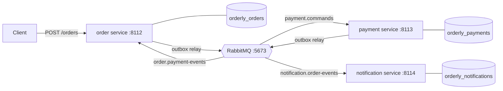
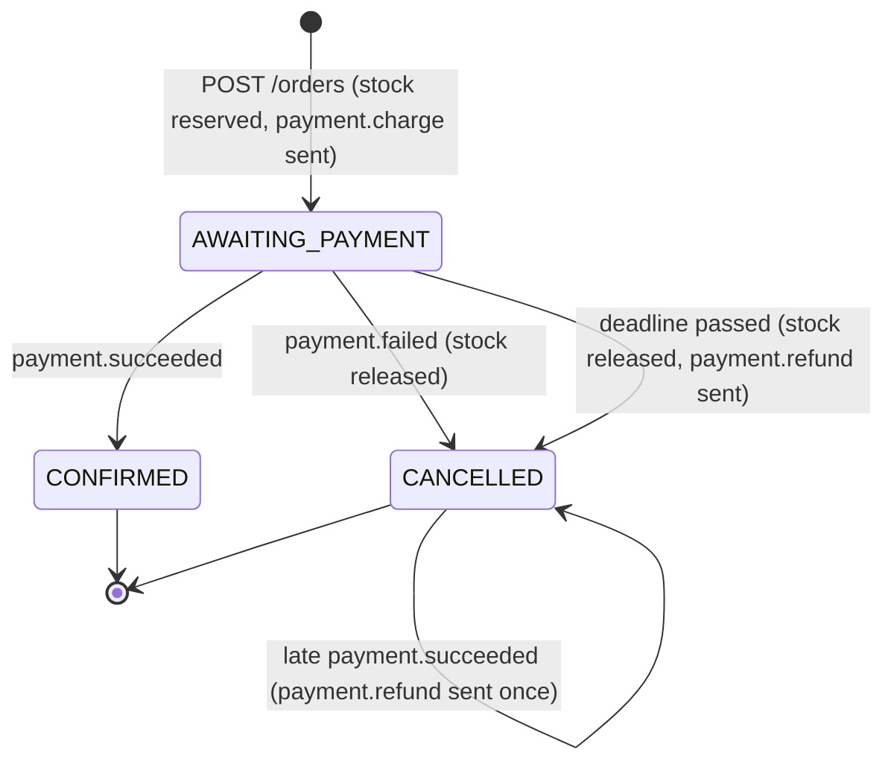

# Orderly: design

Orderly takes one small order-processing monolith and splits it into three services that talk through RabbitMQ:
an **order** service, a **payment** service and a **notification** service, each with its own PostgreSQL database.
The point of the project is the plumbing that makes such a split correct rather than the business logic: a
transactional outbox, idempotent consumers, a saga with compensations, retries, dead letters, and the measurements
that show what the split costs.

This document is the specification for all five days. Sections marked with a day are built that day; until then
they describe the plan.

## The domain

A customer orders a few products. An order is accepted only if every line is in stock; stock is reserved when the
order is created. Then the customer is charged. If the charge succeeds the order is confirmed and the customer gets a
confirmation; if it is declined (or never answered) the reservation is released, the order is cancelled and the
customer is told why.

- **Products** (`sku`, name, unit price in cents, stock). Prices are integer cents with a three-letter currency;
  there is no floating-point money anywhere.
- **Orders** (`id`, customer id, e-mail, lines of `sku` × quantity at the unit price at the time of ordering, total,
  status).
- **Payments**, one per order: a charge through a payment provider, maybe a refund.
- **Notifications**, at most one of each kind per order: "confirmed" or "cancelled".

There is no customer service, no catalogue service and no real provider: the customer id and e-mail come with the
order, products are seeded, and the payment provider and the e-mail sender are fakes inside the services (configurable
latency, declines and errors, so failure handling can be tested and measured).

## The monolith (day 2)

The baseline is what a first version would look like: one FastAPI app, one database (`orderly_monolith`), and
`POST /orders` doing everything in one request and one transaction:

```mermaid
sequenceDiagram
    participant C as Client
    participant M as Monolith
    participant DB as orderly_monolith
    participant P as Payment provider (fake)
    C->>M: POST /orders
    M->>DB: BEGIN; reserve stock; insert order
    M->>P: charge (inside the transaction)
    P-->>M: approved / declined
    M->>DB: insert payment; confirm or cancel; insert notification; COMMIT
    M-->>C: 201 confirmed / 402 declined
```

It is simple and strongly consistent, and that is why it is the baseline. Its problems are the usual reasons to split:

- The provider call happens with a transaction open, holding the stock rows' locks and a connection for the whole
  provider latency: one slow provider slows every order that touches the same products, and exhausts the pool.
- Every part fails together. If sending the e-mail fails, the order fails (or the code grows special cases).
- Everything deploys and scales together; the payment code and the order code share one schema.

The monolith stays in the repo as the reference: the load test (day 4) runs the same orders through both.

## The split



- **Order service**: the products and their stock, orders, and the saga (it is the orchestrator). Owns
  `orderly_orders`.
- **Payment service**: charges and refunds through the provider; one payment per order. Owns `orderly_payments`.
- **Notification service**: sends the confirmation or cancellation. Owns `orderly_notifications`.

Each service owns its database and nothing else reads it; data another service needs travels in messages (the
notification service gets the e-mail address and total in the event, it doesn't look them up). Ports: 8112-8114 for
the services, RabbitMQ on 5673 (one node), PostgreSQL 14 on 5432 with one database per service.

## Orchestration or choreography

There are two ways to run a saga:

- **Choreography**: no one is in charge. The order service publishes `order.created`; the payment service reacts by
  charging and publishes `payment.succeeded` or `payment.failed`; the order service reacts by confirming or
  cancelling; the notification service reacts to those.
- **Orchestration**: one participant (the orchestrator) holds the saga's state and tells the others what to do with
  commands, reacting to their replies.

Orderly uses **orchestration for the payment step and choreography for notifications**:

- The order service keeps each order's saga state in its own row and sends the payment service commands
  (`payment.charge`, `payment.refund`). The flow, including the hard parts (a reply that never comes, a success that
  arrives after the order was cancelled), lives in one place: one pure transition function that can be tested
  exhaustively, and one row that says where every order is. With choreography the timeout and refund rules would be
  spread over two services' event handlers, and "where is order X?" would have no single answer.
- Notifications are a side effect that nothing waits for and that never needs undoing, so the notification service
  just subscribes to `order.confirmed` and `order.cancelled`. Adding another subscriber (say, analytics) changes no
  existing service: that is what choreography is good at.

The cost of orchestration is coupling: the order service knows the payment service's commands. With one downstream
step that is a fair trade; WALKTHROUGH.md argues it either way.

## The saga (day 3)

In saga terms, reserving stock and charging are *compensatable* steps (undone by releasing and refunding),
confirming the order is the *pivot* (after it the saga only goes forward) and the notification is *retriable* (it
must eventually happen, and nothing is undone if it is slow).



- **Creation** (one transaction in `orderly_orders`): check the idempotency key, reserve stock for each line in `sku`
  order (so two orders can't deadlock on each other's rows) with `UPDATE ... SET stock = stock - q WHERE stock >= q`,
  insert the order and its lines with status `AWAITING_PAYMENT` and a payment deadline, and write `payment.charge` to
  the outbox. If any line is short the transaction rolls back and the request gets 409: no saga starts for an order
  that can't be filled.
- **`payment.succeeded`** while awaiting payment: confirm; publish `order.confirmed`.
- **`payment.failed`** while awaiting payment: release the stock, cancel with the provider's reason; publish
  `order.cancelled`.
- **The deadline** (a sweeper in the order service): an order still awaiting payment after its deadline is cancelled
  (`payment_timeout`), its stock released, and both `order.cancelled` and `payment.refund` are written. The refund is
  needed because "no answer" doesn't mean "not charged": the charge may have happened and its reply be stuck in a retry.
- **A late `payment.succeeded`** for a cancelled order: send `payment.refund` if one hasn't been sent; never
  un-cancel. A late `payment.failed` for a cancelled order changes nothing.
- **Anything else** (a duplicate, or a reply for a state that has moved on) is acknowledged and ignored. The
  transition function is total: every (state, message) pair has a defined outcome, and the tests enumerate them.

The payment service is the other half of the timeout rule. It keeps one row per order, and refund and charge commute:

| Payment row | `payment.charge` | `payment.refund` |
|---|---|---|
| none | charge; `succeeded` or `failed` | record `voided`; `refunded` (nothing charged) |
| charged | reply `succeeded` again (same payment) | refund through the provider; `refunded` |
| declined | reply `failed` again | nothing to refund; `refunded` (amount 0) |
| refunded / voided | reply `failed` (`voided`), never charge | reply `refunded` again |

So whichever of charge and refund arrives first (retries and dead-letter replays can reorder them), the customer ends
up not charged for a cancelled order. Calls to the provider carry the order id as an idempotency key, so a charge
retried after a timeout cannot charge twice.

## Messages

Every message is JSON in one envelope; the body is the source of truth and the AMQP properties repeat the envelope's
ids for tools and logs.

```json
{
  "message_id": "6f1c0c1e-6b8e-4c51-9d0e-2f1c4b0e7a10",
  "type": "payment.charge",
  "version": 1,
  "occurred_at": "2026-11-02T20:15:03.123456Z",
  "correlation_id": "0b8f6f8e-1d1f-4f4e-8a3c-7f0f2b9d5e11",
  "causation_id": null,
  "payload": {"order_id": "0b8f6f8e-...", "customer_id": "c-42", "amount_cents": 2599, "currency": "USD"}
}
```

- `message_id` is a UUID chosen when the message is written to the outbox, so a re-publish of the same row carries
  the same id: it is what consumers deduplicate on.
- `correlation_id` is the order id (the saga's id) on every message of that order's saga; `causation_id` is the id of
  the message that caused this one (null for the first).
- `occurred_at` is UTC with microseconds (PostgreSQL's precision, so a time read back from the database compares
  equal) and must end in `Z`.
- Decoding is strict: unknown types, unknown or missing fields, a `version` other than the known one, booleans or
  floats where integers belong, negative amounts (and a zero charge or total: only a refund can be 0, when nothing was
  charged), and a payload that doesn't match its type are all refused
  with a reason. A message that can't be decoded is never retried (it will never decode): it goes straight to the
  dead-letter queue.

| Type | Kind | From → to | Payload |
|---|---|---|---|
| `payment.charge` | command | order → payment | order_id, customer_id, amount_cents, currency |
| `payment.refund` | command | order → payment | order_id, reason |
| `payment.succeeded` | event | payment → order | order_id, payment_id, amount_cents, currency |
| `payment.failed` | event | payment → order | order_id, reason |
| `payment.refunded` | event | payment → order | order_id, payment_id, amount_cents, currency |
| `order.confirmed` | event | order → anyone | order_id, customer_id, email, total_cents, currency |
| `order.cancelled` | event | order → anyone | order_id, customer_id, email, reason |

Commands name the one service that must act; events state a fact anyone may subscribe to.

## RabbitMQ topology

Declared by one module (`orderly.topology`) at every service start, so the broker's shape is code and is tested:

- Exchange **`orderly.commands`** (direct, durable): routing key = command type. Exchange **`orderly.events`** (topic,
  durable): routing key = event type.
- Queues, all **quorum queues** (durable, replicated when there is more than one node, and with a delivery limit that
  stops a poison message from cycling forever):
  - `payment.commands` ← `orderly.commands` with `payment.charge`, `payment.refund`
  - `order.payment-events` ← `orderly.events` with `payment.*`
  - `notification.order-events` ← `orderly.events` with `order.confirmed`, `order.cancelled`
- Each queue has a dead-letter queue `<queue>.dlq` (through the `orderly.dlx` direct exchange), where a message goes
  when it is rejected without requeue (undecodable, or out of retries) or exceeds the delivery limit.
- Retries with backoff (day 3) go through `orderly.retry` and one wait queue per delay (`<queue>.retry.<n>s`, a
  per-queue message TTL, dead-lettering back to the work queue when it expires): RabbitMQ has no delayed delivery
  without a plugin, and per-queue TTLs expire in order, unlike per-message ones.
- Publishing uses publisher confirms and `mandatory`, and messages are persistent: a message the broker can't route is
  an error at the publisher, not a silent drop.

## The transactional outbox (day 2)

A service never publishes from inside a request or a handler. It writes the message to its own `outbox` table in the
same transaction as the change it describes; a relay publishes it afterwards:

```
outbox(id bigserial, message_id uuid unique, exchange, routing_key, body bytea, created_at, published_at null)
```

- The relay claims unpublished rows in id order (`FOR UPDATE SKIP LOCKED`, a batch at a time), publishes each with
  confirms, then marks them published in the same transaction. A crash between publishing and committing the mark
  re-publishes them: **at least once**, with the same `message_id`, which is why every consumer deduplicates.
- A relay stop must not cancel the mark of a batch it just published (that made every restart re-send in an earlier
  project): the publish-and-mark of a batch finishes, and the stop is checked between batches.
- Id order is not commit order (a sequence value is taken before the commit), so the relay doesn't promise a global
  order and nothing relies on one. Within one order the saga only writes its next message after consuming the reply
  to the previous one, so one order's messages are causally ordered anyway.
- `LISTEN/NOTIFY` wakes the relay when a row is written; it also polls, so a lost notification only delays.

## Idempotent consumers (day 3)

Every handler runs in one database transaction that begins by inserting the message's id into
`processed_messages(consumer, message_id)`; if the id is already there, the message is a duplicate and is acknowledged
without doing anything. Otherwise the handler applies its change, writes its outgoing messages to the outbox, commits,
and only then acknowledges. A crash before the acknowledgement means a redelivery, which finds the id and skips. The
notification table also has `unique (order_id, kind)`, so even an event published twice under different ids (which the
outbox never does) can't send two e-mails.

## Failures and how each is handled

| Failure | What happens |
|---|---|
| Broker down | Writes still commit (the outbox fills); relays retry with backoff; nothing is lost (day 4 tests it) |
| A service crashes mid-handler | Its transaction rolls back; the message is redelivered |
| Crash after commit, before ack | Redelivered; deduplicated by `processed_messages` |
| Crash after publish, before the outbox mark | Re-published with the same id; deduplicated |
| Duplicate messages | Deduplicated; the day-4 test sends every message twice |
| A handler's transient error (DB, provider) | Retried through the wait queues with backoff, then dead-lettered |
| An undecodable message | Dead-lettered at once |
| The payment reply never arrives | The deadline cancels the order and sends a refund |
| Charge and refund reordered | They commute (table above) |

## Data

All money is integer cents, all times `timestamptz` in UTC with microsecond precision. Each service database gets its
schema from numbered SQL migrations under `src/orderly/migrations/<service>/`, applied by `orderly.migrate`, which
records each one's SHA-256 and refuses to run against a database whose applied migration has since been edited.

## Testing

- Unit tests for the pure parts: the envelope and payload decoding (with Hypothesis round trips and malformed input),
  the saga's transition function over every (state, message) pair, the payment table above.
- Integration tests against a real RabbitMQ and PostgreSQL (local processes here, service containers in CI): the
  topology routes each type to exactly the queues it should, rejected messages reach the dead-letter queue, migrations
  apply and refuse edits, the outbox relay, the consumers, and whole sagas through all three services.
- Contract tests (day 4): each consumer's expectations about a message checked against what its producer writes.
- Failure injection (day 4): the broker stopped mid-run, every message delivered twice, a provider that times out.

## Measurement (day 4)

A load generator sends 10,000 orders to the monolith and to the services, and reports throughput and end-to-end
latency (order accepted → confirmed or cancelled) at p50/p95/p99, with the provider's latency fixed and stated. All
data synthetic; every number with the command that produced it.

## Days

| Day | Delivers |
|---|---|
| 1 | This design, the repo, local RabbitMQ and PostgreSQL scripts, the message contracts, the topology, the migrations, CI with service containers |
| 2 | The monolith, the order service extracted from it, events through RabbitMQ, the transactional outbox |
| 3 | The payment and notification services, the saga with compensations, idempotent consumers, dead letters, retries with backoff |
| 4 | Contract tests, failure injection (broker down, duplicates), the 10,000-order load test |
| 5 | README with results, WALKTHROUGH.md, v1.0.0 |
