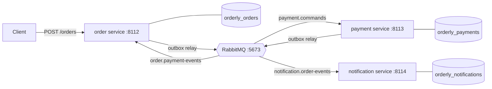
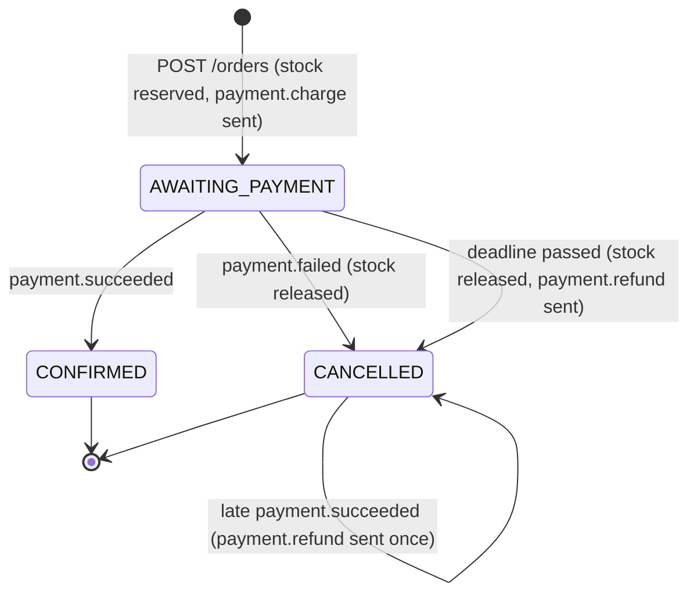

# Orderly: design

Orderly takes one small order-processing monolith and splits it into three services that talk through RabbitMQ:
an **order** service, a **payment** service and a **notification** service, each with its own PostgreSQL database.
The point of the project is the plumbing that makes such a split correct rather than the business logic: a
transactional outbox, idempotent consumers, a saga with compensations, retries, dead letters, and the measurements
that show what the split costs.

This document is the specification for all five days. Sections marked with a day are built that day; until then
they describe the plan.

## The domain

A customer orders a few products. An order is accepted only if every line is in stock; stock is reserved when the
order is created. Then the customer is charged. If the charge succeeds the order is confirmed and the customer gets a
confirmation; if it is declined (or never answered) the reservation is released, the order is cancelled and the
customer is told why.

- **Products** (`sku`, name, unit price in cents, stock). Prices are integer cents with a three-letter currency;
  there is no floating-point money anywhere.
- **Orders** (`id`, customer id, e-mail, lines of `sku` × quantity at the unit price at the time of ordering, total,
  status).
- **Payments**, one per order: a charge through a payment provider, maybe a refund.
- **Notifications**, at most one of each kind per order: "confirmed" or "cancelled".

There is no customer service, no catalogue service and no real provider: the customer id and e-mail come with the
order, products are seeded, and the payment provider and the e-mail sender are fakes inside the services (configurable
latency, declines and errors, so failure handling can be tested and measured).

## The monolith (day 2)

The baseline is what a first version would look like: one FastAPI app, one database (`orderly_monolith`), and
`POST /orders` doing everything in one request and one transaction:

```mermaid
sequenceDiagram
    participant C as Client
    participant M as Monolith
    participant DB as orderly_monolith
    participant P as Payment provider (fake)
    C->>M: POST /orders
    M->>DB: BEGIN; reserve stock; insert order
    M->>P: charge (inside the transaction)
    P-->>M: approved / declined
    M->>DB: insert payment; confirm or cancel; insert notification; COMMIT
    M-->>C: 201 confirmed / 402 declined
```

It is simple and strongly consistent, and that is why it is the baseline. Its problems are the usual reasons to split:

- The provider call happens with a transaction open, holding the stock rows' locks and a connection for the whole
  provider latency: one slow provider slows every order that touches the same products, and exhausts the pool.
- Every part fails together. If sending the e-mail fails, the order fails (or the code grows special cases).
- Everything deploys and scales together; the payment code and the order code share one schema.

The monolith stays in the repo as the reference: the load test (day 4) runs the same orders through both. It has the
same API as the order service and takes its port (8112), so a client points at :8112 either way.

What it does, as built (`orderly.monolith`):

- The order row is inserted **before** the provider is called, as `AWAITING_PAYMENT` (no other transaction ever sees
  that state): inserting it claims the idempotency key, so a concurrent retry with the same key waits on the key's
  unique index instead of charging the customer a second time. Then the payment is recorded, the order confirmed (or
  cancelled with its stock released), the e-mail sent through the fake mailer, and the notification recorded.
- `201` confirmed, `402` declined (the order exists, cancelled), `409` out of stock, `422` a request it can't take,
  `503` with `Retry-After` when the provider or the mailer fails (everything rolled back).

Writing it made the second problem concrete, and the tests pin it rather than hide it: **a failure after the charge**
(the mailer, or the commit itself) rolls the order back but not the charge, so the customer is charged for an order
that doesn't exist; and since no order was committed, the client's retry with the same key is a new order with a new
id, which the provider (idempotent by order id) charges again. One order, two charges. The split fixes it by giving the
charge its own durable record in the payment service and making every later step a retried message instead of part of
one request. The first problem is pinned too: two orders for one product take two provider latencies end to end, two
orders for different products overlap.

## Taking an order (day 2)

The part of the monolith the order service keeps (`orderly.ordering`), shared by both:

- **The request** is validated with the message types (`CustomerId`, `Email`), so an order the API accepts can always
  be put into `payment.charge` and `order.confirmed`; 1-50 lines, each sku once, quantities 1-1000. Prices come from
  the catalogue, never from the client. The database's own checks stay as the backstop.
- **An Idempotency-Key** (1-200 visible ASCII characters) makes a retry safe. The same key with the same request (same
  SHA-256 of its canonical JSON) returns the order the first one created, as it is now, with
  `Idempotent-Replayed: true`; with a different request, `422 idempotency_key_reused`. Two requests with one key at once
  make one order: the second blocks on the key's unique index until the first commits, gets a unique violation, rolls
  back (its reservation with it) and replays the first. And **after an out-of-stock refusal the key is checked again**: a
  retry that waited for the stock its own first attempt took gets that order, not a 409.
- **Stock** is reserved line by line in sku order with `UPDATE products SET stock = stock - q WHERE sku = $1 AND stock
  >= q RETURNING price_cents, currency`: every transaction locks products in the same order, so orders sharing products
  wait instead of deadlocking (a test locks four products in random request orders across 40 concurrent orders;
  locking in request order deadlocks within a few), and `stock >= q` is re-evaluated after a wait, so stock never goes
  negative. The unit price is the locked row's. All lines must share one currency, and the total stay within 10^12
  cents (both `422`).
- Every pooled connection is **pinned to READ COMMITTED**: the reservation relies on re-evaluating `stock >= q` after a
  wait, which REPEATABLE READ would turn into a serialization failure.

The order service's write after the reservation: the order as `AWAITING_PAYMENT` with `payment_deadline = now() +
timeout` (30 s by default), its lines, and `payment.charge` (the order's total, the order id as correlation) to the
outbox, all in the request's transaction; it answers `201` at once. Nothing in the request touches the broker, so orders
are still taken while RabbitMQ is down: their commands wait in the outbox.

## The split



- **Order service**: the products and their stock, orders, and the saga (it is the orchestrator). Owns
  `orderly_orders`.
- **Payment service**: charges and refunds through the provider; one payment per order. Owns `orderly_payments`.
- **Notification service**: sends the confirmation or cancellation. Owns `orderly_notifications`.

Each service owns its database and nothing else reads it; data another service needs travels in messages (the
notification service gets the e-mail address and total in the event, it doesn't look them up). Ports: 8112-8114 for
the services, RabbitMQ on 5673 (one node), PostgreSQL 14 on 5432 with one database per service.

Every service starts the same way (`orderly.service`, day 1): it migrates its own database, declares the whole
topology, and opens its connection pool; if any of that fails it doesn't start, so a service never runs against a
schema or a broker it doesn't expect. `/health` answers 200 only while its database answers (within 2 s) at the
migration this code expects and its broker connection is up, and 503 naming each problem otherwise. "Expects" means
exactly: a schema ahead of the code is unhealthy too. Running old and new versions side by side during a rolling
deploy would need expand/contract migrations and a looser rule; this project deploys one version at a time.

## Orchestration or choreography

There are two ways to run a saga:

- **Choreography**: no one is in charge. The order service publishes `order.created`; the payment service reacts by
  charging and publishes `payment.succeeded` or `payment.failed`; the order service reacts by confirming or
  cancelling; the notification service reacts to those.
- **Orchestration**: one participant (the orchestrator) holds the saga's state and tells the others what to do with
  commands, reacting to their replies.

Orderly uses **orchestration for the payment step and choreography for notifications**:

- The order service keeps each order's saga state in its own row and sends the payment service commands
  (`payment.charge`, `payment.refund`). The flow, including the hard parts (a reply that never comes, a success that
  arrives after the order was cancelled), lives in one place: one pure transition function that can be tested
  exhaustively, and one row that says where every order is. With choreography the timeout and refund rules would be
  spread over two services' event handlers, and "where is order X?" would have no single answer.
- Notifications are a side effect that nothing waits for and that never needs undoing, so the notification service
  just subscribes to `order.confirmed` and `order.cancelled`. Adding another subscriber (say, analytics) changes no
  existing service: that is what choreography is good at.

The cost of orchestration is coupling: the order service knows the payment service's commands. With one downstream
step that is a fair trade; WALKTHROUGH.md argues it either way.

## The saga (day 3)

In saga terms, reserving stock and charging are *compensatable* steps (undone by releasing and refunding),
confirming the order is the *pivot* (after it the saga only goes forward) and the notification is *retriable* (it
must eventually happen, and nothing is undone if it is slow).



- **Creation** (one transaction in `orderly_orders`): check the idempotency key, reserve stock for each line in `sku`
  order (so two orders can't deadlock on each other's rows) with `UPDATE ... SET stock = stock - q WHERE stock >= q`,
  insert the order and its lines with status `AWAITING_PAYMENT` and a payment deadline, and write `payment.charge` to
  the outbox. If any line is short the transaction rolls back and the request gets 409: no saga starts for an order
  that can't be filled.
- **`payment.succeeded`** while awaiting payment: confirm; publish `order.confirmed`.
- **`payment.failed`** while awaiting payment: release the stock, cancel with the provider's reason; publish
  `order.cancelled`.
- **The deadline** (a sweeper in the order service): an order still awaiting payment after its deadline is cancelled
  (`payment_timeout`), its stock released, and both `order.cancelled` and `payment.refund` are written. The refund is
  needed because "no answer" doesn't mean "not charged": the charge may have happened and its reply be stuck in a retry.
- **A late `payment.succeeded`** for a cancelled order: send `payment.refund` if one hasn't been sent; never
  un-cancel. A late `payment.failed` for a cancelled order changes nothing.
- **Anything else** (a duplicate, or a reply for a state that has moved on) is acknowledged and ignored. The
  transition function is total: every (state, message) pair has a defined outcome, and the tests enumerate them.

The payment service is the other half of the timeout rule. It keeps one row per order, and refund and charge commute:

| Payment row | `payment.charge` | `payment.refund` |
|---|---|---|
| none | charge; `succeeded` or `failed` | record `voided` for the refund's amount; `refunded` (0 charged) |
| charged | reply `succeeded` again (same payment) | refund through the provider; `refunded` |
| declined | reply `failed` again | nothing to refund; `refunded` (amount 0) |
| refunded / voided | reply `failed` (`voided`), never charge | reply `refunded` again |

So whichever of charge and refund arrives first (retries and dead-letter replays can reorder them), the customer ends
up not charged for a cancelled order. Calls to the provider carry the order id as an idempotency key, so a charge
retried after a timeout cannot charge twice.

## Messages

Every message is JSON in one envelope; the body is the source of truth and the AMQP properties repeat the envelope's
ids for tools and logs.

```json
{
  "message_id": "6f1c0c1e-6b8e-4c51-9d0e-2f1c4b0e7a10",
  "type": "payment.charge",
  "version": 1,
  "occurred_at": "2026-11-02T20:15:03.123456Z",
  "correlation_id": "0b8f6f8e-1d1f-4f4e-8a3c-7f0f2b9d5e11",
  "causation_id": null,
  "payload": {"order_id": "0b8f6f8e-...", "customer_id": "c-42", "amount_cents": 2599, "currency": "USD"}
}
```

- `message_id` is a UUID chosen when the message is written to the outbox, so a re-publish of the same row carries
  the same id: it is what consumers deduplicate on.
- `correlation_id` is the order id (the saga's id) on every message of that order's saga, and every payload carries
  that `order_id`: a message whose two disagree is refused. `causation_id` is the id of the message that caused this
  one (null for the first).
- `occurred_at` is UTC with microseconds (PostgreSQL's precision, so a time read back from the database compares
  equal) and must end in `Z`.
- Decoding is strict: unknown types, unknown or missing fields, a `version` other than the known one, booleans or
  floats where integers belong, negative amounts (and a zero charge or total: only a refund can be 0, when nothing was
  charged), and a payload that doesn't match its type are all refused
  with a reason. A message that can't be decoded is never retried (it will never decode): it goes straight to the
  dead-letter queue.

| Type | Kind | From → to | Payload |
|---|---|---|---|
| `payment.charge` | command | order → payment | order_id, customer_id, amount_cents, currency |
| `payment.refund` | command | order → payment | order_id, amount_cents, currency, reason |
| `payment.succeeded` | event | payment → order | order_id, payment_id, amount_cents, currency |
| `payment.failed` | event | payment → order | order_id, reason |
| `payment.refunded` | event | payment → order | order_id, payment_id, amount_cents, currency |
| `order.confirmed` | event | order → anyone | order_id, customer_id, email, total_cents, currency |
| `order.cancelled` | event | order → anyone | order_id, customer_id, email, reason |

Commands name the one service that must act; events state a fact anyone may subscribe to.

The contract is also published as a JSON Schema, `docs/message-schema.json` (draft 2020-12, one variant per type),
generated from the code by `scripts/export_message_schema.py` and checked by a test against both the code and every
message the encoder produces. `decode` stays the authority and is stricter than the schema can say: it also refuses
duplicate keys, impossible dates, `2599.0` as an amount, a newline before the end of a pattern-checked string, a
`correlation_id` other than the payload's `order_id`, and a message naming itself as its cause.

## RabbitMQ topology

Declared by one module (`orderly.topology`) at every service start, so the broker's shape is code and is tested:

- Exchange **`orderly.commands`** (direct, durable): routing key = command type. Exchange **`orderly.events`** (topic,
  durable): routing key = event type.
- Queues, all **quorum queues** (durable, replicated when there is more than one node, and with a delivery limit that
  stops a poison message from cycling forever):
  - `payment.commands` ← `orderly.commands` with `payment.charge`, `payment.refund`
  - `order.payment-events` ← `orderly.events` with `payment.*`
  - `notification.order-events` ← `orderly.events` with `order.confirmed`, `order.cancelled`
- Each queue has a dead-letter queue `<queue>.dlq` (through the `orderly.dlx` direct exchange), where a message goes
  when it is rejected without requeue (undecodable, or out of retries) or exceeds the delivery limit (10). Dead-lettering
  is at-least-once (`x-dead-letter-strategy`), so a message isn't lost on its way to the dead-letter queue. The
  dead-letter queues have no delivery limit (`-1`): RabbitMQ 4's default of 20, with nothing behind a dead-letter queue,
  would drop a message whose inspector crashed on it 21 times.
- **What the delivery limit counts** (measured on RabbitMQ 4.3, pinned by tests): a delivery that fails because its
  consumer died with it unacknowledged (channel or connection closed) counts; the 11th such delivery is dead-lettered
  with reason `delivery_limit`. A `basic.nack` or `basic.reject` with `requeue=true` does **not** count: RabbitMQ 4
  treats it as released, so a handler that requeues on a transient error would loop forever. Handlers therefore never
  requeue: a transient error goes to a wait queue (below) with an attempt count in a header, and the limit is only the
  backstop for a message that crashes its consumer.
- RabbitMQ 4.3 refuses a topic binding key with more than two `#` wildcards; Orderly's bindings use none.
- Retries with backoff (day 3) go through `orderly.retry` and one wait queue per delay (`<queue>.retry.<n>s`, a
  per-queue message TTL, dead-lettering back to the work queue when it expires): RabbitMQ has no delayed delivery
  without a plugin, and per-queue TTLs expire in order, unlike per-message ones.
- Publishing uses publisher confirms and `mandatory`, and messages are persistent: a message the broker can't route is
  an error at the publisher, not a silent drop.

## The transactional outbox (day 2)

A service never publishes from inside a request or a handler. It writes the message to its own `outbox` table in the
same transaction as the change it describes; a relay publishes it afterwards:

```
outbox(id bigserial, message_id uuid unique, message_type, body bytea, created_at, published_at null)
```

The row holds the message's type, not an exchange and routing key: the relay asks the topology where a type goes, so
the routing lives in one place.

- The relay claims unpublished rows in id order (`FOR UPDATE SKIP LOCKED`, a batch at a time), publishes each with
  confirms, then marks them published in the same transaction. A crash between publishing and committing the mark
  re-publishes them: **at least once**, with the same `message_id`, which is why every consumer deduplicates.
- A relay stop must not cancel the mark of a batch it just published (that made every restart re-send in an earlier
  project): the publish-and-mark of a batch finishes, and the stop is checked between batches.
- Id order is not commit order (a sequence value is taken before the commit), so the relay doesn't promise a global
  order and nothing relies on one. Within one order the saga only writes its next message after consuming the reply
  to the previous one, so one order's messages are causally ordered anyway.
- `LISTEN/NOTIFY` wakes the relay when a row is written; it also polls, so a lost notification only delays.

As built (`orderly.outbox`, day 2):

- A batch is **published all at once, then confirmed**: every message of the batch goes out before any confirm is
  awaited, so a batch costs about one round trip, not one per message. Rows whose publish failed (returned as
  unroutable, or no confirm within `publish_timeout`, 10 s) stay unpublished and are reported as one `RelayError`; the
  rest of the batch is still marked. A test unbinds a queue: its row stays, the other row of the batch is marked, and
  the next batch after the binding returns publishes it.
- **The loop**: `wake` is cleared before each batch (a NOTIFY while a batch runs means another pass); a full batch goes
  straight to the next; otherwise it waits for a NOTIFY, the poll interval (1 s) or the stop. Database and broker
  errors back off from 0.1 s, doubling to 5 s. The listener has its own connection, sets `wake` once right after
  `LISTEN` (a row committed before it took effect notified no one), and reconnects after a lost connection while
  polling covers the gap. Anything else (a bug) ends the relay, and `/health` says so.
- **A stop** comes through the service skeleton: shutdown sets the workers' stop event and waits for them (up to 10 s)
  before cancelling. A test stops the relay mid-batch; the batch is still marked.
- **Two ways the relay died, found by running it inside the order service and fixed**: aiormq raises `CancelledError`
  into whoever awaits an RPC when the connection closes under it (the relay was opening its channel), though nothing
  cancelled the relay's task; and while a robust connection reconnects, opening a channel raises a bare `RuntimeError`.
  The relay now treats a `CancelledError` as a broker error unless its own task is being cancelled
  (`Task.cancelling()`), and turns that one call's `RuntimeError` into a `ConnectionError`. A test drops the
  connection under a running order service: the robust connection reconnects (the test sets `reconnect_interval=0.5`;
  aio-pika's default is 5 s) and the relay publishes the orders taken meanwhile.

## Idempotent consumers (day 3)

Every handler runs in one database transaction that begins by inserting the message's id into
`processed_messages(consumer, message_id)`; if the id is already there, the message is a duplicate and is acknowledged
without doing anything. Otherwise the handler applies its change, writes its outgoing messages to the outbox, commits,
and only then acknowledges. A crash before the acknowledgement means a redelivery, which finds the id and skips. The
notification table also has `unique (order_id, kind)`, so even an event published twice under different ids (which the
outbox never does) can't send two e-mails.

## Failures and how each is handled

| Failure | What happens |
|---|---|
| Broker down | Writes still commit (the outbox fills); relays retry with backoff; nothing is lost (day 4 tests it) |
| A service crashes mid-handler | Its transaction rolls back; the message is redelivered |
| Crash after commit, before ack | Redelivered; deduplicated by `processed_messages` |
| Crash after publish, before the outbox mark | Re-published with the same id; deduplicated |
| Duplicate messages | Deduplicated; the day-4 test sends every message twice |
| A handler's transient error (DB, provider) | Retried through the wait queues with backoff, then dead-lettered |
| An undecodable message | Dead-lettered at once |
| The payment reply never arrives | The deadline cancels the order and sends a refund |
| Charge and refund reordered | They commute (table above) |

## Data

All money is integer cents, all times `timestamptz` in UTC with microsecond precision. Each service database gets its
schema from numbered SQL migrations under `src/orderly/migrations/<service>/`, applied by `orderly.migrate`:

- all pending migrations in **one transaction** (PostgreSQL's DDL is transactional), so a failure leaves the database
  as it was, bookkeeping included;
- under a **transaction-level advisory lock**, so services starting together don't both apply them (taken before the
  `CREATE TABLE IF NOT EXISTS schema_migrations`, which itself races without it);
- each applied migration's name and SHA-256 recorded, and a database whose history doesn't match the files (an
  applied migration edited or renamed, a gap, a migration this code doesn't have) **refused**, not repaired;
- a migrations folder holding anything but `NNNN_name.sql` files numbered 1, 2, 3... is an error, so a misnamed file
  can't be skipped silently.

The schemas (day 1, `0001_initial.sql` for each service) put the invariants in the database too: stock never below
zero, a cancelled order has a reason and only a cancelled one does, an idempotency key always has its request hash, an
order line's `sku` once per order, a payment's provider references matching its status, one notification of each kind
per order.

## Testing

- Unit tests for the pure parts: the envelope and payload decoding (with Hypothesis round trips and malformed input),
  the saga's transition function over every (state, message) pair, the payment table above.
- Integration tests against a real RabbitMQ and PostgreSQL (local processes here, service containers in CI): the
  topology routes each type to exactly the queues it should, rejected messages reach the dead-letter queue, migrations
  apply and refuse edits, the outbox relay, the consumers, and whole sagas through all three services.
- Contract tests (day 4): each consumer's expectations about a message checked against what its producer writes.
- Failure injection (day 4): the broker stopped mid-run, every message delivered twice, a provider that times out.

## Measurement (day 4)

A load generator sends 10,000 orders to the monolith and to the services, and reports throughput and end-to-end
latency (order accepted → confirmed or cancelled) at p50/p95/p99, with the provider's latency fixed and stated. All
data synthetic; every number with the command that produced it.

## Days

| Day | Delivers |
|---|---|
| 1 | This design, the repo, local RabbitMQ and PostgreSQL scripts, the message contracts (and their JSON Schema), the topology, the migrations, the service skeleton (startup, `/health`), CI with service containers |
| 2 | The monolith, the order service extracted from it, events through RabbitMQ, the transactional outbox |
| 3 | The payment and notification services, the saga with compensations, idempotent consumers, dead letters, retries with backoff |
| 4 | Contract tests, failure injection (broker down, duplicates), the 10,000-order load test |
| 5 | README with results, WALKTHROUGH.md, v1.0.0 |
