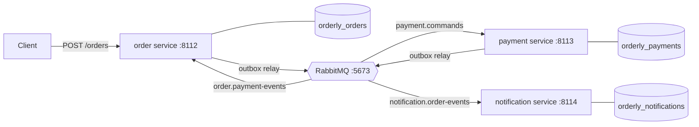

# Orderly

An order-processing monolith split into event-driven services: an **order** service, a **payment** service and a
**notification** service, each with its own PostgreSQL database, talking through RabbitMQ. The interesting part is the
plumbing that keeps such a split correct: a transactional outbox, idempotent consumers, a saga with compensations
(including a payment reply that never comes), retries, dead letters, and measurements of what the split costs against
the monolith.

Python 3.11, FastAPI, RabbitMQ 4.3 (aio-pika), PostgreSQL 14 (psycopg 3), pytest. MIT licensed.

**Status: day 5 of 5, the release.** Day 1: the design, the message contracts, the RabbitMQ topology, the database schemas and
their migrations, the local RabbitMQ and PostgreSQL scripts, CI. Day 2: the monolith baseline, the order service
extracted from it, and the transactional outbox with its relay. Day 3: the payment and notification services, the saga
with its compensations (stock released, refunds, a deadline), idempotent consumers, retries through wait queues with
backoff, and dead letters; an order now goes from `POST /orders` to its e-mail through all three services. Day 4:
consumer-driven contract tests, failure injection (the broker cut mid-run, every message twice, a provider that loses
its answers), the 10,000-order load test against the monolith, and a fix it found (the services sat idle for seconds
after a broker restart). Day 5: a tool to list, replay and discard dead letters (`python -m orderly.dead_letters`),
each service's `/health` counting its dead letters, and the release ([CHANGELOG.md](CHANGELOG.md)).

**Reading order**: this README's architecture and "Results (day 4)", then [WALKTHROUGH.md](WALKTHROUGH.md) "In two
minutes", then [DESIGN.md](DESIGN.md) for the full specification. In the code: `saga.py` (the saga as a pure
function), `ordering.py` and `orders.py` (taking an order, the saga's consumer and sweeper), `outbox.py`, `consumer.py`,
`payments.py`, then `dead_letters.py`.

## Architecture



- The order service runs the saga (orchestration): it reserves stock, sends `payment.charge`, and confirms or cancels
  on the reply; if no reply comes by a deadline it cancels and sends `payment.refund`, because "no answer" doesn't mean
  "not charged". The payment service makes charge and refund commute, so their order doesn't matter.
- Notifications are choreographed: the notification service subscribes to `order.confirmed` and `order.cancelled`.
- No service publishes directly: each writes messages to an outbox table in the same transaction as its change, and
  a relay publishes them (at least once). Every consumer deduplicates by message id.

[DESIGN.md](DESIGN.md) is the full specification: the monolith baseline and what it gets wrong, orchestration vs
choreography, the saga's states, the message table, the topology, the outbox, the failure table.

## What's here

| Path | What it is |
|---|---|
| `src/orderly/monolith.py` | The baseline (day 2): the whole order in one request and one transaction, the provider and the mailer called inside it |
| `src/orderly/ordering.py` | Taking an order, shared by the monolith and the order service: request validation, Idempotency-Key replay, stock reserved in sku order |
| `src/orderly/orders.py` | The order service: the order and its `payment.charge` written in one transaction (day 2); the saga's reply consumer and deadline sweeper, each applying `saga.transition` to the locked order (day 3); the outbox relay |
| `src/orderly/saga.py` | The order's saga as a pure, total transition function: 4 states by 6 inputs, every pair tested (day 3) |
| `src/orderly/payment_rules.py` | The payment table as pure functions: what a charge or refund does to an order's payment row, and the reply (day 3) |
| `src/orderly/payments.py` | The payment service (day 3): payment.commands applied one order at a time (advisory lock), the provider called in the transaction, a refund before any charge voiding at the provider; replies through its outbox |
| `src/orderly/notifications.py` | The notification service (day 3): one e-mail per order and kind, retried, at least once |
| `src/orderly/consumer.py` | The idempotent consumer every service uses (day 3): `processed_messages` in the handler's transaction, retries through the wait queues, dead letters, a stop that drains, resubscribing after a broker drop |
| `src/orderly/dead_letters.py` | The dead-letter tool (day 5): list, replay (a header-less copy to the work queue it died in, confirmed before the dead letter is acknowledged) and discard by id; `python -m orderly.dead_letters` |
| `src/orderly/outbox.py` | The transactional outbox: `write` in the change's transaction, `Relay` claiming in id order with `SKIP LOCKED`, publishing a batch, confirming, marking; LISTEN/NOTIFY wake-up |
| `src/orderly/order_api.py` | `POST /orders` and `GET /orders/{id}`, the same for both apps |
| `src/orderly/fakes.py`, `src/orderly/emails.py` | The deterministic fake payment provider (idempotent charges, refunds and voids by order id) and mailer; the two e-mails |
| `src/orderly/seed.py` | A synthetic catalogue: `python -m orderly.seed orders` |
| `src/orderly/messages.py` | The contract: a JSON envelope around seven typed payloads; `decode` is strict and says why it refuses, `encode` is canonical |
| `docs/message-schema.json` | The same contract as a JSON Schema, generated from the code (`scripts/export_message_schema.py`) and checked by tests |
| `contracts/*.json` | Consumer-driven contracts (day 4): per consumer, each message it takes, the producer state behind it, and the fields it reads; `tests/test_contracts.py` checks both sides |
| `src/orderly/topology.py` | Exchanges, quorum queues, dead-letter queues, the retry wait queues (1 s, 5 s, 30 s) and bindings as code; `routes()` says where each type goes |
| `src/orderly/broker.py` | Persistent, mandatory, confirmed publishing on a channel where a returned message is an error |
| `src/orderly/service.py` | The skeleton every service shares: migrate and declare at startup, `/health` (200 only with its database, schema, broker and workers right), routes and background workers stopped by an event, every connection READ COMMITTED; ports 8112-8114 (the monolith takes 8112) |
| `src/orderly/migrate.py`, `src/orderly/migrations/` | Numbered SQL migrations per service, applied in one transaction under an advisory lock; edited history refused |
| `scripts/rabbitmq.sh` | A local RabbitMQ node on 127.0.0.1:5673, kept apart from any other RabbitMQ on the machine |
| `scripts/postgres.sh` | Creates, migrates, lists and drops Orderly's databases on the local PostgreSQL 14 (`ORDERLY_PG_PREFIX` renames them) |
| `scripts/measure_test_fixture.py` | Times CREATE DATABASE against CREATE SCHEMA (why each test gets a schema) |
| `scripts/measure_relay.py`, `scripts/measure_intake.py` | The relay's throughput by batch size; order intake, monolith against order service, on one hot product |
| `scripts/load_test.py` | The 10,000-order load test (day 4): the monolith or the three services as processes, open or closed loop, end-to-end latency to the outcome event, the books checked; `--broker-outage` stops the node mid-run; `make load-test` |
| `results/load/*.json` | The load test runs in the README, as the script wrote them (settings, summary, books) |
| `tests/chaos.py`, `tests/shop.py` | A TCP proxy in front of RabbitMQ that tests cut and restore; the three services in one process for whole-saga tests |
| `tests/` | 649 tests: unit, property and integration tests against the real servers, whole sagas through the three services |
| `.github/workflows/ci.yml` | Lint, mypy --strict and the suite with PostgreSQL 14 and RabbitMQ 4.3 service containers |

## Run it

Needs Python 3.11, RabbitMQ (`brew install rabbitmq`) and a PostgreSQL 14 server on localhost:5432.

```bash
make venv              # .venv with the package and its dev tools
make services-up       # scripts/rabbitmq.sh start + scripts/postgres.sh create (databases, migrations)
make check             # ruff, ruff format --check, mypy --strict, pytest
make load-test         # the day-4 load test's four runs (about 8 minutes; needs ports 8112-8114 free)
make services-down     # stop the RabbitMQ node (the databases stay)
```

Run the three services (each migrates its database and declares the topology first) with a synthetic catalogue, and
follow an order through them:

```bash
.venv/bin/python -m orderly.seed orders                # SKU-0001..SKU-0100, 10,000 units each
ORDERLY_PROVIDER_LATENCY_MS=50 .venv/bin/python -m orderly.service payments &     # 127.0.0.1:8113
.venv/bin/python -m orderly.service notifications &    # 127.0.0.1:8114
.venv/bin/python -m orderly.service orders             # 127.0.0.1:8112
curl -s http://127.0.0.1:8112/health                   # {"service":"orders","schema_expected":2,"schema":2,"outbox":{...},"status":"ok","problems":{}}
curl -s -H 'content-type: application/json' -H 'Idempotency-Key: try-1' http://127.0.0.1:8112/orders \
  -d '{"customer_id":"c-1","email":"ada@example.com","lines":[{"sku":"SKU-0001","quantity":2}]}'
curl -s http://127.0.0.1:8112/orders/<id>              # CONFIRMED a moment later
curl -s http://127.0.0.1:8113/payments/<id>            # CHARGED, with the provider's reference
curl -s http://127.0.0.1:8114/notifications/<id>       # the confirmation e-mail
```

The answer to the POST is `201` with the order `AWAITING_PAYMENT`; the same request again replays it
(`Idempotent-Replayed: true`). `ORDERLY_PROVIDER_DECLINE_RATIO=0.3` on the payment service declines some orders (they
end `CANCELLED`, stock back). An order whose payment doesn't answer by `ORDERLY_PAYMENT_TIMEOUT_S` (30 s) is cancelled
by the sweeper (it looks every second) and refunded; `tests/test_sagas_end_to_end.py` runs that with a provider slower
than the deadline. Or run the monolith instead, on 8112, where the order is charged and
confirmed inside the request:

```bash
.venv/bin/python -m orderly.seed monolith
ORDERLY_PROVIDER_LATENCY_MS=50 ORDERLY_PROVIDER_DECLINE_RATIO=0.1 .venv/bin/python -m orderly.service monolith
```

Settings: `ORDERLY_<SERVICE>_DATABASE_URL`, `ORDERLY_AMQP_URL` (the services add `reconnect_interval=1` unless it
sets one), `ORDERLY_TOPOLOGY_PREFIX` (none; the load test's own topology), `ORDERLY_POOL_SIZE` (10),
`ORDERLY_POOL_TIMEOUT_S` (5, at most 5), `ORDERLY_MAX_AWAITING_PAYMENT` (none: the cap on orders awaiting payment,
503 above it), `ORDERLY_PAYMENT_TIMEOUT_S` (30, the order service's payment deadline), and the fake provider's
`ORDERLY_PROVIDER_LATENCY_MS`, `ORDERLY_PROVIDER_DECLINE_RATIO`, `ORDERLY_PROVIDER_ERROR_RATIO` (0), and the fake
mailer's `ORDERLY_MAILER_LATENCY_MS`, `ORDERLY_MAILER_FAILURE_RATIO` (0).

When a message is dead-lettered (refused, or failed on all four attempts), the service logs why under its id, and its
`/health` counts it (`"dead_letters": {"queue": "payment.commands.dlq", "waiting": 1}`). Once the cause is fixed:

```bash
.venv/bin/python -m orderly.dead_letters list                       # every dead-letter queue, changing nothing
.venv/bin/python -m orderly.dead_letters replay payment.commands --id <message id> --dry-run
.venv/bin/python -m orderly.dead_letters replay payment.commands --all
.venv/bin/python -m orderly.dead_letters discard payment.commands --id <message id>   # one that will never work
```

`--json` prints one object per dead letter; the exit status is 0 when everything asked for was done, 1 when a dead
letter to replay or discard is still there (not found, can't be replayed, not confirmed), 2 for a bad command line.

The scripts on their own:

```bash
scripts/rabbitmq.sh start | stop | status | url | logs [n] | reset
scripts/postgres.sh create | migrate | status | drop
.venv/bin/python -m orderly.migrate orders --url postgresql://localhost:5432/orderly_orders
```

`rabbitmq.sh` keeps its node's data, logs and config in `.rabbitmq/`, ignores Homebrew's `rabbitmq-env.conf` and
`enabled_plugins` (which would add the management UI, MQTT, STOMP and streams, each on another port), and binds AMQP,
Erlang distribution (25673) and epmd to loopback.

## Tests

`make check` runs 649 tests in about 2.5 minutes here (141.7-146.0 s for the pytest part on day 5; 124-132 s for day
4's 629, 120.5 s for day 3's 516, 74.6 s for day 2's 366, 30.7 s for day 1's 231). Day 5's (20 new):

- **The dead-letter tool** (17, `tests/test_dead_letters.py`, real RabbitMQ): a listing describes each dead letter (id,
  type, order, last attempt, RabbitMQ's reason and time) and changes nothing; the reason is the last death's, not
  `x-first-death-reason` (which says `expired` for anything that went through a wait queue); the replayed copy has the
  original's body and properties and no headers; an undecodable dead letter and one whose type isn't routed to that
  queue are kept, then discarded by id; only the chosen ids are replayed; a dry run changes nothing; a replay the broker
  can't route keeps the dead letter; the limit; unknown queues refused; the routes equal each consumer's `ACCEPTS`; a
  replay handled once by a real consumer with its attempts restarted (failed once more after the replay, it is retried,
  not dead-lettered); a replay interrupted between the confirm and the acknowledgement, replayed again and skipped as a
  duplicate; the command line's output, exit statuses and refusals; back-to-back passes each seeing everything.
- **End to end** (1, `tests/test_sagas_end_to_end.py`): a charge outliving the order's deadline, a refund
  dead-lettered while the provider's refunds are down (a cancelled order's customer charged), replayed once they are
  back: refunded, net 0, one e-mail.
- **`/health`** (2, `tests/test_service.py`): a dead letter counted while the status stays 200; the count unknown when
  the broker connection is closed; each service's work queue as its module names it.

Day 4's (98 new):

- **Contracts** (68, `tests/test_contracts.py`, `contracts/*.json`): 11 interactions, each checked as a contract (well
  formed; the example a canonical message, valid by the published JSON Schema; routed to its consumer and in its
  `ACCEPTS`; every type a consumer takes covered), against its consumer (the handler does what `then` says in the stated
  state; changing any field the contract doesn't list changes nothing it does) and against its producer (the producer's
  own code, driven into `given`, writes a message whose listed fields match). Three mutants, each failing: the e-mail
  mentioning the customer id, a declined order announced as timed out, a charge made for another customer.
- **Failure injection** (6, `tests/test_failure_injection.py`, the three services through `tests/chaos.py`'s proxy):
  the broker cut for 1.5 s while 30 orders are taken, then all 50 settle once; every message published twice; both
  outboxes re-sent whole; a charge's answer lost once (charged once) and every time (refunded by the deadline's void);
  every worker's backoff pinned at 30 s and the orders still settling within seconds of the broker's return. Each ends
  with the books. Disabling the consumer's `processed_messages` check fails both duplicate tests; the old relay and
  consumer fail the last one.
- **The awaiting cap** (3, `tests/test_orders_service.py`): past the cap a 503 with Retry-After that reserves, writes
  and sends nothing, and an order taken again once one leaves `AWAITING_PAYMENT`; two requests with one key racing for
  the last place both get the one order (fails 3 of 3 without the key's re-check); the setting.
- **The load test's own arithmetic** (7, `tests/test_load_test.py`): nearest-rank percentiles in integers, the orders
  fixed by the seed and all valid requests, the summary counting only timed orders, the recovery measured from the
  node's restart, refusals counted and timed apart, the exit status. **The skeleton** (7): `ORDERLY_TOPOLOGY_PREFIX`
  and its refusals; the reconnect interval, in the URL and on a running service's connection. **The review's** (3,
  `tests/review_d4/`): the proxy's cut race and the contracts' envelope blind spot (each failed 3 of 3 before its
  fix), and the open loop timed from the due times (kills three load-test mutants); round 2's (2,
  `tests/review_d4r2/`), each failing 3 of 3 before its fix.

Day 3's:

- **The saga's rules** (54, `tests/test_saga.py`): the full table of 24 (state, input) pairs, each with its outcome,
  status and effects, and which are anomalies; only a step out of awaiting payment changes the status or releases
  stock; Hypothesis runs of random reply sequences (duplicates, reorderings): stock released, outcome announced and
  refund asked at most once, a cancelled order after any success always refunded, a confirmed one never, a repeated
  input changing nothing.
- **The payment rules** (27, `tests/test_payment_rules.py`): the table for every row and command, contradictions
  refused, and Hypothesis sequences of charges and refunds in any order: a refunded order ends with nothing charged,
  money never negative nor above one charge, a repeated command answered alike.
- **The consumer** (18, `tests/test_consumer.py`, real servers, 0.2/0.4 s delays): handled once; a duplicate skipped;
  eight concurrent copies handled once; concurrency up to the prefetch; undecodable and foreign types dead-lettered;
  two failures then success with each delay between attempts and one effect; failing for good dead-lettered after the
  last delay with nothing kept and the id unrecorded (so a replay is handled); `Refused`; the handler timeout; a stop
  mid-handler that still commits and acknowledges; aiormq's bare `Exception()` survived; the stop's bound against the
  services' stop timeout, a broker that never answers the cancel or the close, a cancel on a channel closed under it
  still draining.
- **The payment service** (11): approved and declined charges; a redelivery deduplicated and a repeated command
  answered with the same payment; a refund after the charge; a refund first, and the charge never taken; a charge whose
  transaction was lost refunded by the void; 20 orders with charge and refund delivered together ending with nothing
  charged (fails without the per-order lock); a provider outage retried; a contradiction dead-lettered; a charge after
  a lost void answered "voided", and one after a lost void that refunded it recorded `REFUNDED` (11 in all).
- **The order service's saga** (9): a success confirms and announces; a decline cancels and returns the stock; the
  deadline cancels, returns the stock and asks for a refund; a success after the deadline covered by that refund; a
  success after a decline refunded once; ruled-out replies changing nothing; an unknown order dead-lettered; 30
  successes racing their deadlines ending confirmed without a refund or cancelled with one, stock matching; an order
  locked by a reply not holding up the sweeper (9 in all). And the
  day-2 broker-drop test now sends a reply after the drop and sees it consumed.
- **The notification service** (6): a confirmation (in JPY, minor units), a cancellation's text for each reason, one
  e-mail for a redelivery and for the same fact under a second id, a mailer outage retried, a mailer down for good
  dead-lettering the event.
- **End to end** (5, `tests/test_sagas_end_to_end.py`, the three services in one process): approved, declined, a
  provider slower than the deadline (cancelled, refunded, nothing charged), 60 orders with a quarter declined and the
  provider's first two calls failing for about 30% of them (every order settles, one e-mail each, the provider's net
  equals the confirmed totals, stock matches), and a charge failing all four attempts (dead-lettered, timed out,
  voided).
- **The retry topology** (12 in `tests/test_topology.py`): names, arguments, labels and validation; a message coming
  back to each work queue after each delay with its body and attempt header; the TTL fixed at declaration. **Fakes**
  (5): refunds and voids, idempotent, only of an approved charge of that amount. **The reviews'** (3,
  `tests/review_d3/`, `tests/review_d3r2/`): each failed 3 of 3 on the code it was written against, passes now. **The
  skeleton** (5): a pool timeout above 5 s, or of 0 or less, refused at startup; the relay's margin with the longest one
  accepted.

Day 2's:

- **The monolith** (23, `tests/test_monolith.py`): confirmed (stock, payment, notification, e-mail), declined (402, stock back),
  refused orders writing and charging nothing (out of stock, unknown sku, mixed currencies, a total over the limit),
  malformed requests and keys; replays without a second charge, a reused key refused; ten concurrent requests under
  one key making one order and one charge; a retry that waited for its own first attempt's stock getting the order,
  not a 409; 12 orders racing for 3 units (3 confirmed, never oversold); 40 orders locking the same four products in
  random orders without a deadlock (locking in request order deadlocks); a failing provider rolling back; a pool
  timeout answering 503; and the two flaws, pinned: a failure after the charge keeps the charge and the retry charges
  again, and two orders for one product take two provider latencies.
- **Taking an order** (34, `tests/test_ordering.py`): what the request accepts and refuses, the fingerprint, the key's
  characters.
- **The outbox** (31, `tests/test_outbox.py`, real servers): the NOTIFY on commit only; id order; batch sizes; routing;
  two relays publishing 600 rows exactly once (fails without `SKIP LOCKED`); a crash before the mark re-publishing
  the same bytes; an unroutable row left while the rest of its batch is marked (fails if failed rows are marked); a
  closed channel replaced; the NOTIFY waking a relay whose poll is 30 s; polling without a listener; a stop mid-batch
  that still marks; backing off and recovering; a `CancelledError` from the broker library not ending the relay, a
  real cancel ending it; a lost listener reconnecting, with a row written meanwhile going out at the reconnect;
  another schema's writes not waking it; a failing row's own wait (0.5 s from the failure, doubling to a minute) and
  error text; a missing confirm counted as the broker's, not the row's; a backlog draining without the poll; the
  backoff reset; `SKIP LOCKED` letting a second relay take the next rows; a NOTIFY during a batch kept; a claim behind
  a table lock and a channel that never opens, each giving up within its bound.
- **The order service** (13, `tests/test_orders_service.py`): the order and its command end to end to the
  `payment.commands` queue; the deadline; no command for a refused order or a replay; 50 concurrent orders, 50
  commands; an outbox failure rolling the order back; orders taken while the broker is closed; a real connection drop,
  then the outbox drained after the reconnect; `/health` reporting a backlog and a failing row without failing.
- **The skeleton** (day 2's additions): the monolith never connecting to a broker, READ COMMITTED under a REPEATABLE
  READ default, workers awaited at shutdown (cancelled only after the timeout, which outwaits any default batch), a
  dead worker making `/health` 503. And DateStyle pinned to ISO (a review test).
- **Fakes and seed** (28): deterministic declines and per-attempt errors, idempotent charges, the e-mails' wording
  and integer money in each currency's minor unit, the catalogue.
- **The review's tests** (6, `tests/review_d2/` and `tests/review_d2r2/`): each failed on the code it was written
  against and passes now.

Day 1's:

- **Messages** (84): the canonical bytes pinned; malformed inputs each refused for its own reason (duplicate keys,
  NaN, a full-width digit in a time, booleans and floats as integers, non-canonical UUIDs, a 5,000-digit number,
  100,000 nested brackets, a correlation id that isn't the order, a message naming itself as its cause...); the
  boundaries next to them accepted; Hypothesis round trips over all seven types; changed fields that decode or are
  refused, never raise anything else; arbitrary bytes; the published JSON Schema matching the code, accepting every
  encoded message as exactly one variant, refusing what it can express, and laxer than the decoder exactly where
  documented.
- **Topology** (28, on a real RabbitMQ): every type reaches exactly the queues `routes()` names; the queue arguments,
  exchange types and durability pinned (the broker refuses a redeclaration with others); an unroutable publish is an
  error, and `publish` refuses a channel that would only log it; rejected and poison messages are dead-lettered; the
  delivery limit's actual behaviour (below); `delete()` leaves nothing; `topic_matches` agrees with the broker on
  1,665 (pattern, key) pairs, the empty pattern and key among them.
- **Migrations** (25) and **schemas** (31, on PostgreSQL 14): applying once and in order; a failing migration leaves
  nothing, not even the bookkeeping; edited (whitespace included), renamed, newer and gapped histories refused, and
  history read in version order whatever the storage order; four migrators started at once apply once; a connection
  inside a transaction refused; each invariant of DESIGN.md "Data" enforced by the database itself.
- **The service skeleton** (14): each service starts by migrating its database and declaring the topology, then
  `/health` says 200; a schema behind or ahead of the code, a lost database pool, a database slower than the 2 s
  timeout, a closed or reconnecting broker connection each give 503 naming the problem; edited migration history or
  an unreachable broker stops the start; a pool that can't fill is closed; shutdown closes the pool and the broker.
- **The scripts**: `rabbitmq.sh` (10, each starting its own node, and a fake `lsof` printing 1 MB: start/stop/status, loopback-only listeners, a busy
  port, a foreign directory left alone, a live pid that isn't the node neither signalled nor forgotten, a stale pid
  file, a symlinked directory, a long `lsof` listing) and `postgres.sh` (10, on databases under a random `ORDERLY_PG_PREFIX`: create makes
  and migrates them once, with `PYTHON=python` as CI passes it; status; drop asks, then drops only its own four; a
  prefix that isn't a plain identifier refused).
- **The review's tests** (28, `tests/review_d1/` and `tests/review_d1r2/`): each failed on the code it was written
  against and passes now.
- And one that the package's version matches `pyproject.toml`.

A full run leaves nothing behind on the shared servers (no queue, exchange, schema or database; checked after a run
with `rabbitmqctl list_queues` / `list_exchanges` and `pg_namespace` / `pg_database`).

Tests that need a server find it at `ORDERLY_AMQP_URL` and `ORDERLY_TEST_DATABASE_URL` (defaults: the local ones) and
are skipped when it isn't there, except with `ORDERLY_REQUIRE_SERVICES=1` (CI sets it), where a missing server fails
them. Each test isolates itself on the shared servers: a random prefix on every exchange and queue it declares, and a
private schema in the test database.

## Results at v1.0.0

The release's numbers are day 4's runs below, not re-measured on day 5: day 5 added a separate tool and a count in
`/health`, and changed nothing an order goes through. In one table (all from `results/load/*.json` and the outage
samples, synthetic data, one laptop):

| What | Monolith | Services |
|---|---|---|
| End to end at 100 orders/s, p50 / p99 | 58.0 / 135.6 ms | 60.8 / 78.5 ms (the POST answered in 3.4 ms at p50) |
| 64 closed-loop clients: taken / settled per second | 130.6 / 130.6 | 359.4 / 171.0, and 2,769 of 10,000 timed out and refunded |
| The same with the awaiting cap at 1,000 | | 0 timed out; 3,990 refused with 503; end-to-end p99 8.3 s |
| Broker stopped for about 14 s at 100/s: first order settled after the restart | | 0.18 / 0.37 s (2.15 / 2.97 s before the day-4 fix) |
| Orders lost, in every run | 0 | 0 (the books checked order by order) |

## Results (day 4)

Measured on an Apple M3 laptop (macOS 26.6.2, on AC power, load average 3.0-7.6, with `avconferenced` and a video
encoder using about a third of a core alongside), PostgreSQL 14.20, RabbitMQ 4.3.6, 15:24-15:45. Synthetic data:
10,000 timed orders per run (200 untimed before them), each of 1-3 of 100 products, 1-3 units each (`--seed 1`); the
fake provider at 50 ms per call, declining 10% of orders by id; the services' payment deadline 30 s. Every process on
the one machine, over loopback HTTP and AMQP. The table is `scripts/results_table.py` over the runs' own
`results/load/*.json`. Every run's books agreed: every order settled once, the `CHARGED` cents equal to the
`CONFIRMED` totals, the units taken equal to the confirmed units, one notification per order, nothing dead-lettered.

```bash
make load-test        # the four runs below: scripts/load_test.py {monolith,services} --orders 10000 {--rate 100,--concurrency 64}
.venv/bin/python scripts/results_table.py results/load/monolith-rate100.json results/load/services-rate100.json \
    results/load/monolith-c64.json results/load/services-c64.json
```

| Target | Loop | Sent/s | Settled/s | Accept ms p50 / p95 / p99 / max | End to end ms p50 / p95 / p99 / max | Outcomes | Books |
|---|---|---|---|---|---|---|---|
| monolith | open, 100/s | 99.9 | 99.9 | 57.3 / 102.1 / 134.8 / 264.8 | 58.0 / 102.7 / 135.6 / 265.6 | 8,974 confirmed, 1,026 declined cancelled | agree |
| services | open, 100/s | 100.0 | 99.9 | 3.4 / 5.7 / 7.9 / 70.6 | 60.8 / 65.8 / 78.5 / 138.0 | 9,001 confirmed, 999 declined cancelled | agree |
| monolith | closed, 64 clients | 130.6 | 130.6 | 479.4 / 582.4 / 704.2 / 1,055.1 | 479.4 / 582.4 / 704.2 / 1,055.1 | 8,973 confirmed, 1,027 declined cancelled | agree |
| services | closed, 64 clients | 359.4 | 171.0 | 106.9 / 566.3 / 1,054.0 / 4,885.9 | 20,444.8 / 31,003.8 / 31,238.3 / 31,851.4 | 6,512 confirmed, 719 declined, 2,769 timeout cancelled | agree |

Accept is the POST's latency; end to end runs from the order's due time (open loop) or its send (closed loop) to its
outcome, which for the services is the `order.confirmed`/`order.cancelled` event read off the broker.

What they say:

- **At a rate both can take (100 orders/s), the split costs 3 ms at the median and halves the tail.** The monolith
  answers in one request: 58.0 ms median, about one provider call plus its own work. The services answer the POST in
  3.4 ms and announce the outcome 60.8 ms after it was due: five more hops (outbox, relay, broker, consumer, and back)
  for about 3 ms. But the monolith's p99 is 135.6 ms against 78.5 ms: it holds every product row it reserved for the
  whole provider call, so orders sharing a product wait for each other's 50 ms; the services hold no product row
  across the provider call (it is in another service).
- **Offered as much as 64 clients can send, the monolith pushes back and the services don't.** The monolith settles
  130.6 orders/s and its clients simply wait (p50 479 ms): its pool of 10 connections, each held for a provider call,
  is the limit. The services take 359.4 orders/s, because taking an order no longer waits for the payment, but settle
  only 171.0/s: the payment service holds a connection per provider call too, 8 at a time (its prefetch), so about 8 /
  50 ms. The backlog grows, and 2,769 orders reach their 30 s deadline unpaid and are cancelled (`payment_timeout`):
  2,475 of them had been charged by then and were refunded, 294 declined anyway. Nobody was charged for a cancelled
  order, but a client of the split needs either backpressure (a limit on orders awaiting payment) or more payment
  capacity; the monolith's slowness was its backpressure. So the order service now has one, opt-in (next).

**The cap on orders awaiting payment** (`ORDERLY_MAX_AWAITING_PAYMENT`, added after the run above): the same 64
clients against the services with at most 1,000 orders awaiting payment (16:10, commit `07addae`; load average 10.1
at the start, with Spotlight indexing and WhatsApp each using most of a core, so its rates are lower than the run
above's for that reason too). The first row is the run above again:

```bash
.venv/bin/python scripts/load_test.py services --orders 10000 --concurrency 64 --max-awaiting 1000 \
    --json results/load/services-c64-cap1000.json --samples results/load/samples/services-c64-cap1000.csv
```

| Target | Loop | Sent/s | Settled/s | Accept ms p50 / p95 / p99 / max | End to end ms p50 / p95 / p99 / max | Outcomes | Books |
|---|---|---|---|---|---|---|---|
| services | closed, 64 clients | 359.4 | 171.0 | 106.9 / 566.3 / 1,054.0 / 4,885.9 | 20,444.8 / 31,003.8 / 31,238.3 / 31,851.4 | 6,512 confirmed, 719 declined, 2,769 timeout cancelled | agree |
| services | closed, 64 clients | 269.2 | 136.1 | 145.9 / 931.8 / 1,848.3 / 3,913.0 | 6,961.0 / 8,071.4 / 8,347.4 / 9,106.6 | 5,386 confirmed, 624 declined cancelled; 3,990 refused (503, the cap) | agree |

- **No order timed out**: 6,010 were taken and every one settled (5,386 confirmed, 624 declined), against 2,769 timed
  out and refunded without the cap. Their end-to-end p99 was 8.3 s (31.2 s without), about what 1,000 orders ahead
  take at 136/s.
- **3,990 were turned away** with `503 too_many_awaiting_payment` and `Retry-After: 1`, nothing written for them.
  Not instantly on this overloaded laptop: 112.4 ms at the median, 980.3 ms at p99 (answered - sent of the refused
  orders, from the committed samples), about what an accepted order took to answer (145.9 ms).
- So the split can push back like the monolith did, but only if someone picks the number: about the payment
  service's rate times the wait you will accept, well under the deadline (here 1,000 / 136 per s, about 7 s, against
  30 s).

**A broker outage** (`--broker-outage 30 10`: `scripts/rabbitmq.sh stop` 30 s into the timed orders, `start` 10 s
after it returned, about 14 s down in all), at 100 orders/s, before and after the day's fix:

```bash
.venv/bin/python scripts/load_test.py services --orders 10000 --rate 100 --broker-outage 30 10 \
    --json results/load/services-outage-after-1.json --samples results/load/samples/services-outage-after-1.csv
.venv/bin/python scripts/outage_recovery.py results/load/services-outage-after-1.json \
    results/load/samples/services-outage-after-1.csv     # the recovery numbers (committed samples: .csv.gz)
```

| Run | Target | Loop | Sent/s | Settled/s | Accept ms p50 / p95 / p99 / max | End to end ms p50 / p95 / p99 / max | Outcomes | Books |
|---|---|---|---|---|---|---|---|---|
| before the fix (`077ef11`), run 1 | services | open, 100/s, node stopped at 30 s, back at 44 s | 100.0 | 99.9 | 3.4 / 7.6 / 12.1 / 62.2 | 1,463.5 / 14,881.3 / 16,101.0 / 16,705.6 | 9,017 confirmed, 983 declined cancelled | agree |
| before the fix, run 2 | services | open, 100/s, node stopped at 30 s, back at 44 s | 100.0 | 99.9 | 3.0 / 8.3 / 11.2 / 48.6 | 1,531.0 / 14,864.6 / 16,099.8 / 16,699.0 | 9,052 confirmed, 948 declined cancelled | agree |
| after the fix (`346e86b`), run 1 | services | open, 100/s, node stopped at 30 s, back at 44 s | 100.0 | 99.9 | 3.5 / 6.9 / 10.4 / 55.7 | 64.2 / 12,614.8 / 13,803.6 / 14,409.6 | 9,053 confirmed, 947 declined cancelled | agree |
| after the fix, run 2 | services | open, 100/s, node stopped at 30 s, back at 44 s | 100.0 | 99.9 | 3.7 / 7.1 / 9.2 / 77.0 | 64.2 / 12,612.9 / 13,812.8 / 14,377.5 | 9,012 confirmed, 988 declined cancelled | agree |

| Run | First order settled after the restart | Backlog (orders taken before it) cleared | Caught up (last order over 1 s settled) | Orders over 1 s |
|---|---|---|---|---|
| before, run 1 | 2.15 s | 12.10 s | 38.59 s | 5,180 |
| before, run 2 | 2.97 s | 12.27 s | 39.13 s | 5,180 |
| after, run 1 | 0.18 s | 9.83 s | 30.89 s | 4,409 |
| after, run 2 | 0.37 s | 9.97 s | 31.11 s | 4,380 |

- **Nothing was lost**: the orders kept coming in during the outage (201 at a p99 of 9-12 ms, their commands waiting in
  the outbox) and every one settled once, with the books agreeing, in all four runs.
- **The fix**: before it, the services sat idle for 2-3 s after the node was back: aio-pika's robust connection retries
  every 5 s by default, and the relay's and consumer's own backoff had grown to its 5 s cap. Now they reconnect every
  second and the reconnect itself wakes the workers (`broker.reconnects`), so the first order settles 0.2-0.4 s after
  the restart.
- **Why 2.5 s idle cost 8 s**: the backlog drains only as fast as the payment service outpaces the arrivals, about
  145 - 100 = 45 orders/s, so every second spent idle after the restart adds about 3 s before the services catch up
  (38.6-39.1 s before, 30.9-31.1 s after). The end-to-end p50 in the table (1.5 s before, 64 ms after) is a threshold
  effect of the same thing, not a 20-fold speedup: in a 100 s run with a 14 s outage the median order sits right at the
  end of the catch-up.
- The outcomes are timed when the load test's own listener receives them, and that listener reconnects too (every
  0.5 s), so an event announced while it was reconnecting is timed late: the "first order settled" numbers are upper
  bounds, by up to half a second (day-4 review).
- These are two runs each on a laptop with other work running; the direction is clear, the decimals aren't.

## Results (day 3)

Day 3 is about correctness; its numbers are the tests above and these runs (Apple M3, macOS 26.6.2, on AC, PostgreSQL
14.20, RabbitMQ 4.3.6, synthetic data). The throughput and latency of whole sagas are day 4's load test.

- **The three services as separate processes** (`python -m orderly.service orders|payments|notifications`, provider at
  50 ms, 15:56): `/health` 200 on each; an order of 2 × SKU-0001 + 1 × SKU-0002 was `AWAITING_PAYMENT` (22,075 cents)
  at once and `CONFIRMED` when read 1.5 s later (not a latency measurement), its payment `CHARGED`, its confirmation recorded; a day-2 smoke order still
  awaiting payment (its charge had been consumed by hand that day) was cancelled by the sweeper (`payment_timeout`),
  its refund voided it at the provider (`VOIDED`); clean SIGINT exits.
- **The retry wait queues**: one probe saw a message in a 0.3 s wait queue back in its work queue after 0.31 s.
- `make check`: 516 tests, the pytest part 120.5 s (one run at 15:50).

## Results (day 2)

Measured on an Apple M3 laptop (macOS 26.6.2, on battery, load average 1.9-3.8), PostgreSQL 14.20, RabbitMQ 4.3.6,
15:56-16:00 with nothing else using the servers. Synthetic data. Each script runs in process (the order intake through
httpx's ASGI transport: no HTTP server or network in the path).

| What | Measured (3 runs) | Command |
|---|---|---|
| Relay, 5,000 `payment.charge` rows, messages/s by batch size | batch 1: 974-1,002 (median 995); 10: 4,060-4,234 (4,154); 100: 6,296-6,470 (6,392); 500: 6,812-6,856 (6,854) | `.venv/bin/python scripts/measure_relay.py --messages 5000 --runs 3` |
| The broker alone, 5,000 confirmed publishes, messages/s | each confirm awaited before the next: 3,039-3,138 (3,053); all published, then the confirms: 9,404-9,846 (9,716) | same run |
| Order intake, one hot product, the monolith's provider at 50 ms, 1 client | monolith p50 58.8-59.6 ms, p99 63.2-65.2 ms, 16.8-17.0 orders/s; order service p50 1.5-1.6 ms, p99 2.4-2.9 ms, 596-643 orders/s | `.venv/bin/python scripts/measure_intake.py --orders 400 --provider-ms 50 --concurrency 1 20` |
| The same, 20 clients | monolith p50 1,007-1,041 ms, p99 2.26-2.82 s, 16.9-17.1 orders/s; order service p50 25.3-29.1 ms, p99 66.7-76.2 ms, 607-685 orders/s | same run |

A re-run of `measure_relay.py` at 16:20, after the review's second-round change to the relay, came out lower in every
row (relay batch 100: median 5,335/s; the broker alone: 1,301 and 4,321/s), but another project's process was using
about four cores by then (`ps -Ao pcpu,comm -r`) and the broker-alone rows, which don't run the relay at all, fell as
much, so that run says nothing about the change. The change touches only the relay's failure paths.

What they say:

- **The monolith's hot product is capped by the provider**: about 17 orders/s with one client or twenty, which is one
  order per provider call (50 ms) plus its own ~9 ms, because every order for that product waits for the previous
  one's row lock. More clients only make the queue longer: p50 goes from 59 ms to about a second.
- **The order service's number is intake, not confirmation**: it answers once the order and its command are committed,
  without waiting for a payment, and on day 2 nothing confirms an order yet. The end-to-end comparison (accepted to
  confirmed) is the day-4 load test, once the payment service exists. What this does show is that taking an order no
  longer holds the product's row through a provider call.
- **Batching is most of the relay's speed**: one message per batch costs a transaction and a confirm round trip each
  (995/s); 100 per batch reaches 6,392/s. On the broker alone, publishing everything before awaiting the confirms is
  3.2 times faster than awaiting each confirm in turn.

## Results (day 1)

Measured on an Apple M3 laptop (macOS 26.6.2, on battery), PostgreSQL 14.20, RabbitMQ 4.3.6 (Erlang 28).

| What | Measured | Command |
|---|---|---|
| A poison message (its consumer dies before acking, every time) | dead-lettered after 1 + 10 deliveries, reason `delivery_limit` | `pytest tests/test_topology.py -k keeps_dying` |
| `basic.nack` with requeue, 20 times | never counted toward the limit (no `x-delivery-count`), never dead-lettered | `pytest tests/test_topology.py -k requeueing` |
| CREATE + DROP DATABASE vs SCHEMA | 36-198 + 12-21 ms vs 0.1-0.6 + 0.1-0.3 ms (5 runs each) | `.venv/bin/python scripts/measure_test_fixture.py` |
| Local RabbitMQ node, start to AMQP port open | 1.58, 1.58, 1.59 s | `ORDERLY_RABBITMQ_DIR=.scratch/rmq-measure ORDERLY_RABBITMQ_PORT=24601 ORDERLY_RABBITMQ_NODE=orderly-measure@localhost /usr/bin/time -p scripts/rabbitmq.sh start` (then `stop`; three times) |

The second row is the day's most useful finding: on RabbitMQ 4, requeueing a message is "released", not "failed",
so a consumer that requeues on a transient error would loop forever without the delivery limit ever stopping it. The
retries (day 3) therefore never requeue: they go through wait queues with their own attempt count.

## Review of day 4

One review agent, in its own git worktree, read the day's code at `e2c03bf` (15:48-16:00, about 12 minutes, ~205k
tokens) with a correctness brief, wrote each finding as a test and ran 8 mutants. Two defects, both in the day's test
infrastructure, each test failing 3 of 3 before its fix and passing after:

| Defect | Fix |
|---|---|
| `chaos.Proxy.cut()` aborted only connections already linked; one accepted just before a cut whose upstream connect finished after it was linked and pumped, so it went on talking to the broker the proxy called unreachable | `cut()` bumps a counter that `_accept` checks after connecting; a connection cut meanwhile is aborted both ways (`ceb2acd`, `tests/review_d4/`) |
| The contract tests' "ignores every unlisted field" check compared what a consumer wrote as type and payload only, so a consumer stamping its reply with the command's `occurred_at` (or copying its `causation_id`) passed while its contract left those out | the written messages are compared whole: a value copied from the incoming message kept, a fresh id or time blanked (`d0617c3`) |

Its suspicions: a drain that timed out was reported like one that went quiet, and the books could then say "agree".
My own first capped run then went wrong in the same code: refused orders are never written, but the drain and the
books expected every order sent, so it waited out its 120 s and the books said "disagree". Both fixed in `07addae`
(they count the orders accepted, and a drain that times out fails the books), which also builds the outcome listener's URL with `robust_url`. Noted in the results: the listener's own 0.5 s reconnect
makes "first order settled after the restart" an upper bound. Its mutants: three of the load test survived its unit
tests (end to end from the send instead of the due time, the warm-ups kept, the send time recorded as the due time);
its test of the open loop against a fake client (`tests/review_d4/`) kills all three. Dropping `robust_url` from the
services' start-up survived too; `test_a_running_service_reconnects_every_second` kills it. Also from its suspicions: the books compared
sums (confirmed cents against charged cents, units taken against units confirmed), so two offsetting errors would
pass; they now check every order against its own payment and notifications too (the runs in the tables above were
checked by the sums; smoke runs since pass both). Not acted on: `outcomes_while_stopped` counts from the stop request, not from the node being down. What held: no lost
or spinning wake-up in `broker.reconnects` (aio-pika calls the callback after restoring channels; the event is set
through the attempt's error); the outage test really puts every worker in its 30 s backoff; every recovery number in
this README recomputes from the committed samples.

**Round 2** (one agent at `07addae`, 16:12-16:25, ~210k tokens, "what did the fixes break, and is the cap right?"):
two defects, both in the day's own fixes, each test failing 3 of 3 before and passing after:

| Defect | Fix |
|---|---|
| The recovery numbers counted the cap's 503s as orders that settled: with `--max-awaiting` and `--broker-outage` together, refusals answered from PostgreSQL while the node was down would make the services look recovered at once | only accepted orders' outcomes go to `recovery()`, in the run and in `outage_recovery.py` (`d3acef6`) |
| `ceb2acd` read the proxy's cut count in the handler's first step, which a cut in the same loop iteration could run before, so a connection accepted just before the cut still went through | the count is passed by the accept callback itself, and checked first (`70b8927`) |

Also from it: `create_app(max_awaiting=0)` refused like the environment's 0; the docstrings name the cap's 503. What
held: a refusal by the cap writes nothing (stock, order, lines, outbox, key); the count never includes the request's
own order, and a same-key twin is always committed before it; `Overloaded` can't reach the monolith; the 503's body is
what the load test matches. Its surviving mutants are in `wait_drained`, `books` and `accepted_all`, which no unit
test covers (they need the load databases and a broker): a test with fakes for them is day 5's. Not acted on: the
envelope check catches copied values but not ones derived from an unlisted field (a time plus a microsecond); a
handler in flight is invisible to the drain check, which could only make the books fail, not pass.

## Review of day 3

One review agent, in its own git worktree, read the day's code at `52f28ef` (15:56-16:10, about 14 minutes) with a
correctness brief, wrote each finding as a failing test and mutated 11 load-bearing lines. One defect, fixed, its test
failing 3 of 3 before and passing 3 of 3 after:

| Defect | Fix |
|---|---|
| aiormq raises `ChannelInvalidStateError` (a `RuntimeError`, not an `AMQPError`) for `set_qos`, `get_queue` or `consume` on a channel the broker has closed; `Consumer.run` didn't back off on it, so a channel closed between the open and the subscription ended the consumer for good (the order service would stop taking replies, the payment service stop charging) | a `RuntimeError` from the subscription steps is a `ConnectionError`: back off, subscribe again; the stop's cancel suppresses it too (`ec6abea`, `tests/review_d3/`) |

Of its suspicions, one was real and is fixed: a charge arriving after a refund's void had reached the provider (with
the void's transaction lost) was dead-lettered as a conflict instead of answered "failed (voided)" as the table says
(`54811f6`). Its one surviving mutant (`FOR UPDATE` without `SKIP LOCKED` in the sweeper: correct, since `lock_order`
re-reads the row, but the sweeper would wait behind a reply) has a test now that fails on it (`36be0f3`). Not acted
on: a message replayed from a dead-letter queue keeps its attempt count (a replay tool must reset it: Limitations);
duplicate retry chains if a handler outlived the drain, which the bounds rule out (a handler is cut off at 10 s, its
retry publish at 5 s, the drain waits 16 s). What held: the transition function and payment rules against DESIGN's
tables; no lock-order cycle among the advisory lock, `processed_messages`, the order rows and the products; stock
released exactly once; 30 random connection drops (4 seeds) with the consumer always consuming again afterwards.

A second round (one agent at `36be0f3`, 16:20-16:27, "what did the fixes break?", `tests/review_d3r2/`) found two
defects, both in the bounded stop the first round's follow-up added (`a913720`), and both fixed in `70884c5`, each
test failing 3 of 3 before:

| Defect | Fix |
|---|---|
| A cancel that times out leaves the subscription live (aiormq forgets a consumer only on `CancelOk`): new deliveries started handlers during the drain, which waited only for its snapshot, so `run` returned with a handler running, which then committed and acknowledged on a closed channel | once a stop begins, a delivery starts no handler (left unacknowledged, it goes back with the channel); the drain waits for the live set |
| `stop_bound` wasn't a bound: the subscription's calls had no timeout and the open wasn't counted | every channel call bounded by `control_timeout` (2 s); `stop_bound` = 4 × 2 + 16 = 24 s, under the 30 s `STOP_TIMEOUT` |

Its surviving mutant (the close's timeout removed) has a test now. Its two tests' setup is adapted to `control_timeout`
(assertions unchanged). Of the two guards in the first fix, the test fails only with both removed: the stop flag alone
is enough (it is set before the drain), the drain's loop is a second guard. Its unproven suspicion was real and is fixed
(`test_a_charge_after_a_lost_void_that_refunded_it_is_recorded_refunded`): a charge redelivered after a void that had
refunded an earlier charge (both transactions lost) got the provider's old "approved" back, so the row said `CHARGED`
while the money had been given back (and stayed wrong if the refund's retries ran out). A voided key now refuses even
its old charge, saying what the void settled, and the payment service records `REFUNDED` with both references. What held: `ProviderVoided`
against every row state and ordering, the `RuntimeError` conversion limited to the subscription, notifications under
concurrency, the sweeper with a reply holding the row.

## Review of day 2

One review agent, in its own git worktree, read the day's code at `00ebdc4` (15:28-15:43) with a correctness brief and
wrote each finding as a failing test (`tests/review_d2/`). Four defects, all fixed, each test failing before its fix and
passing after:

| Defect | Fix |
|---|---|
| Once `batch_size` outbox rows kept failing (an unroutable type), every claim took exactly those rows again: nothing behind them was ever published | per-row retries: `attempts`, `last_error`, `next_attempt_at` (migration 0002), claims skip rows still waiting (`3b571be`) |
| One failing row put the whole relay on a backoff up to 5 s that ignored NOTIFY, for as long as it kept failing | a partial failure no longer backs the relay off (`3b571be`) |
| A stop could cancel a batch between publish and mark: shutdown cancelled after 10 s, a batch could wait 10 s for its confirms, so a confirmed message was sent again after the restart | confirms 5 s, `STOP_TIMEOUT` 30 s, and a test of the margin (`1244d4e`) |
| Under a DateStyle other than ISO every POST /orders failed (psycopg parses timestamptz only in ISO), after the monolith had charged | the pool pins DateStyle too (`a828a9a`) |

Its eight surviving mutants (all in the relay but the 10^12-cent boundary) each have a test now and fail it when
re-applied (`c957980`; the first, the look after `LISTEN`, was already caught by `b956811`). It suspected the NOTIFY
test was flaky across concurrent runs sharing the test database, which holds: the payload names the schema now and a
relay ignores other schemas (`32c0e05`). Its other suspicions are under Limitations. What held: no way found for an
Idempotency-Key to give two orders, two charges or a wrong replay beyond the monolith's pinned flaw; stock re-checked
under the pinned READ COMMITTED; locks always in sku order.

A second round (one agent at `c957980`, 16:00-16:10, "what did the fixes break?") found two defects in the per-row
retries, both fixed in `cf8109f`: a broker-wide failure (a deleted exchange, confirms timing out) was charged to every
row, so after the broker recovered the rows kept waiting out their own delays (now only a row's own failure, an
unroutable return or an undecodable row, is charged; anything else backs the relay off); and a failed row's wait was
counted from the claim's `now()`, so a failure late in a slow batch was due before it was recorded (`clock_timestamp()`
now). Its outage test is kept with its setup adapted (it waited for five charged attempts, which the fix no longer
makes), and its timing test recast onto a row failure late in a slow batch, since a missing confirm is no longer the
row's; both fail on the code before the fix. Its two surviving mutants and its lone-surrogate suspicion have tests. Its
inference that STOP_TIMEOUT wasn't a real bound (a channel open with no timeout, a claim waiting on a table lock) led to
bounding both (`cdd03d8`).

## Review of day 1

One review agent, in its own git worktree, read the code at `5edf504` (15:33-15:48) with a correctness brief and
wrote each finding as a failing test (`tests/review_d1/`). Seven defects, all fixed:

| Defect | Fix |
|---|---|
| CI's last step could never pass: `postgres.sh` tested `[ -x "$PYTHON" ]`, false for `PYTHON=python` (a clean-clone rehearsal of the CI steps found it too) | `5f21e1e` |
| `postgres.sh create` and `drop` exited 0 after a failed statement (`q ... && echo`: `set -e` ignores the left of `&&`) | `d30e814` |
| The dead-letter queues had RabbitMQ 4's default delivery limit (20) and nothing behind them: a message whose inspector crashed on it 21 times was dropped | `b71cc16` |
| Under `default_transaction_isolation = 'repeatable read'` a migrator that waited for the lock didn't see the other's work and failed with DuplicateTable | `073733b` |
| `topic_matches` treated the empty routing key as one word, unlike RabbitMQ | `b82315e` |
| An e-mail with NUL or another control character decoded, then could never be stored | `c1f5ed1` |
| A `correlation_id` other than the payload's `order_id` decoded | `bf15f1a` |

Its mutation pass listed the non-equivalent survivors in `messages.py`, `topology.py` and `migrate.py` (22 mutants as
re-applied here); each now has a test, and each mutant was re-applied and fails it (`2d43faa`, `dcdd337`). Its suspicions (a self-caused message,
`publish` on a channel that only logs returns, `lsof | grep -q` under `pipefail`, a test that could leak an exchange)
were settled in `3c83729`. What held: no input made `decode` raise anything but `InvalidMessage`; the round trip held
for years 1 to 9999; the routing, the confirmed mandatory publish and both delivery-limit claims; the history checks
under READ COMMITTED; the scripts refusing what isn't theirs.

A second round (16:19-16:29, at `031b35f`) asked what the fixes and the new code broke. Three defects, all fixed:
`/health` answered 503 once per pooled connection the server had ended (no pool check; `ac9da17`); the e-mail
pattern's `\s` meant different sets in Rust, Python and ECMA-262, so the published schema refused an e-mail with
U+FEFF that `decode` accepted (whitespace now spelled out, checked against Node; `ea77e71`); and `postgres.sh` read a
failed existence check as "missing" and still exited 0 (`ebdd7ec`). Its surviving mutants (shutdown closing the
broker, the health timeout, the reconnecting state, the `lsof` pipe, the C1 boundary) are tested now, and "a schema
ahead of the code is unhealthy" is pinned as a decision (`dd3e265`). What held: READ COMMITTED with a SERIALIZABLE
connection and with the lock already held, `-1` really meaning no limit, cleanup on every failed start.

## Design decisions

- **Orchestration for payment, choreography for notifications**: the flow with a timeout and a refund lives in one
  pure transition function and one row per order; the side effect nobody waits for is a subscription.
- **Charge and refund commute** in the payment service (a refund first voids the payment), so retries and dead-letter
  replays can reorder them safely.
- **A strict decoder**: a message that doesn't decode never will, so it is dead-lettered at once, never retried;
  being strict about the canonical form means two services can't disagree on what a message says.
- **Quorum queues with at-least-once dead-lettering** and a delivery limit as the backstop for poison messages.
- **Mandatory, confirmed publishing on a channel that raises on returns**: aio-pika only logs a returned message by
  default, so an unroutable message looked like a success until the first test showed it.
- **The database enforces the invariants too** (stock never negative, a cancellation always has a reason, one payment
  per order...): the code is the first line, the schema the last.
- **Migrations in one transaction under an advisory lock**, history checked by SHA-256 and refused if it differs.
- **The monolith inserts the order before charging**, so the idempotency key is claimed first and a concurrent retry
  waits instead of charging twice. Its remaining flaws are kept and pinned by tests: they are the baseline.
- **One order-taking module for both apps**: the order service is literally the monolith's order-taking code with the
  charge replaced by an outbox write, so the day-4 comparison measures the split, not two implementations.
- **Re-check the idempotency key after a refusal**: a retry blocked behind its own first attempt sees "out of stock".
- **Stock locked in sku order, READ COMMITTED pinned**: no deadlocks, and the `stock >= q` re-check after a wait.
- **The relay publishes a batch, then awaits its confirms**, marks only what was confirmed, and is stopped by an event
  between batches, never cancelled mid-batch.
- **A `CancelledError` the task didn't ask for is a broker error**: aiormq raises one into an RPC's caller when the
  connection closes; only `Task.cancelling()` says the task itself is being cancelled.
- **A pool timeout is a 503 with Retry-After**, not a 500.
- **The saga's rules and the payment table are pure functions** (`saga.py`, `payment_rules.py`), applied by thin
  database code: the tests enumerate every pair and run random sequences without a server.
- **A refund before any recorded charge voids at the provider**: a charge whose transaction never committed may have
  taken the money, so recording a void locally isn't enough (day 3).
- **One payment command at a time per order** (a transaction-level advisory lock), and the provider called inside the
  transaction: no intermediate state to recover, because the provider's calls are idempotent by order id.
- **Retries through wait queues, never requeues**: RabbitMQ 4 doesn't count a requeue toward the delivery limit, so a
  requeue on a persistent error loops forever; a wait queue per delay gives backoff without a plugin.
- **The consumer owns its recovery**: on any close of its channel it closes it for good and subscribes again, rather
  than trusting aio-pika's robust channel to restore a subscription it doesn't know about.
- **Contracts owned by the consumers, checked on both sides** (day 4): each consumer's file says which fields it reads;
  its own test proves it reads no others (changing them changes nothing), and the producer's proves it sends them.
  Plain JSON and pytest rather than a contract framework: one repo, three consumers, and the check that matters (the
  producer's real code in a named state) is ordinary test code.
- **The broker cut by a proxy in tests, stopped for real in the load test**: a proxy keeps tests independent of each
  other and of the CI service container; stopping the node is the harsher case (forced closes, recovery from disk).
- **Open loop, measured to the outcome event, books checked after every run**: a closed loop hides a stall as a slower
  sender; the services' "done" is the event a subscriber sees, not the 201; and a fast run that loses an order is a
  failure, so every run ends with the databases agreeing or it says so.
- **A cap on orders awaiting payment, answered 503 with Retry-After** (day 4, opt-in): the load test showed the split
  saying yes to everything and letting the deadline refund what it couldn't charge; a 503 tells the client at once.
  503 rather than 429: the service is out of capacity for everyone, not limiting this client.
- **Workers wake on the reconnect, not only on their backoff** (day 4): a backoff exists to spare a broker that's down,
  so once the connection is back there is nothing left to wait for.
- **Dead letters replayed into the queue they died in, by hand** (day 5): through the default exchange, so a replayed
  event reaches only the consumer that failed it, not every subscriber again; with no headers, so its attempts start
  over; never automatically, because a message is dead-lettered when retrying didn't fix it, and replaying before the
  cause is fixed only dead-letters it again.
- **Dead letters counted in `/health`, never a 503** (day 5): the service is doing its job for every other message;
  the count is for an alert, like the outbox's failing rows.

## Limitations

- A dead-lettered message waits for an operator: a dead-lettered `payment.refund` (the provider failing all four
  attempts) leaves a cancelled order's customer charged until someone replays it with `orderly.dead_letters`. `/health`
  counts the dead letters, but nothing here alerts on the count. Why each one died is in the service's log, not in the
  message (a reject can't add headers).
- The dead-letter tool holds every message it takes until the end of its pass (at most `--limit`, 1,000 by default),
  so a pass over a very large dead-letter queue holds that many unacknowledged messages.
- The confirmation e-mail is at least once: a crash between the send and the commit sends it again.
- The payment service holds a database connection for each provider call in flight (8 at most per instance, the
  consumer's prefetch), so a slow provider limits its throughput to 8 / latency per instance: about 160 orders/s at
  50 ms (171 settled/s measured on day 4, timeouts included).
- **Backpressure is opt-in and approximate**: without `ORDERLY_MAX_AWAITING_PAYMENT` the order service takes orders as
  fast as it can write them (359/s with 64 clients) whatever the payment service can charge, and an overload turns
  into payment timeouts and refunds (2,769 of 10,000 orders in the day-4 closed-loop run). With it, the count isn't
  locked, so concurrent requests can overshoot the cap by up to the pool's size; it is checked after the stock is
  reserved (rolled back on a refusal); and the right number depends on the payment service's rate, which nothing
  measures for you.
- The load test runs every process (three services, PostgreSQL, RabbitMQ, the generator) on one laptop over loopback:
  the numbers include their contention for the same cores and no network latency.
- The outage the load test injects stops the only node; with a cluster, quorum queues would fail over instead, which
  isn't measured.
- The contracts live in this repo next to both sides. Split into separate repos, they would need publishing to where
  each producer's CI can fetch them (what a contract broker does).
- The sweeper looks every second, so an order is cancelled up to a second after its deadline.
- Anomalies (replies the protocol rules out) are only logged, not counted or alerted on.
- The monolith's flaws are deliberate (it is the baseline): a failure after the charge leaves the charge, and its retry
  charges again.
- An outbox row that can never be published (a type no binding routes) is retried forever, its wait doubling from
  0.5 s to a minute, with `attempts` and `last_error` in its row; there is no parking place for it and no alert. It
  doesn't hold up the rows behind it (the day-2 review found that it did).
- `/health` reports the outbox (unpublished rows, rows failing on their own, the oldest row's age) but never fails on
  it: a stuck row is for an alert to catch, and there is no alerting here.
- A batch's claim transaction stays open while it waits for confirms (5 s at most), so a server with
  `idle_in_transaction_session_timeout` under that would end it and the batch would be published again.
- Shutdown waits 30 s for a batch, which outwaits every bounded wait of one (a pooled connection 5 s, the channel's
  open 5 s, two table-lock waits 5 s each, the confirms 5 s). A longer `ORDERLY_POOL_TIMEOUT_S` would break that
  margin, so since day 3 a service refuses to start with one above 5 s (or with 0).
- `last_error` is capped at 1,000 characters by a CHECK on `length()`, which counts characters in a UTF-8 database (all
  of Orderly's) but bytes in a SQL_ASCII one.
- The relay doesn't promise a global order across orders (ids are taken before commit); nothing relies on one.
- The fakes keep their state in memory: restarting the monolith or the payment service forgets its provider's charges
  (the payment rows stay).
- The RabbitMQ script tests run only where RabbitMQ is installed; CI uses a service container and skips them.
- One RabbitMQ node: quorum queues are replicated only on a cluster, which this project doesn't run.
- The orders schema checks e-mails with PostgreSQL's `[:space:]`, the messages with their own spelled-out set; the API
  validates requests with the message types (day 2), so the database check is only the backstop.

## License

MIT. See [LICENSE](LICENSE).
