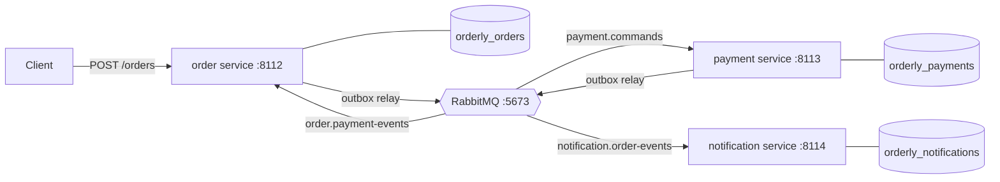

# Orderly

An order-processing monolith split into event-driven services: an **order** service, a **payment** service and a
**notification** service, each with its own PostgreSQL database, talking through RabbitMQ. The interesting part is the
plumbing that keeps such a split correct: a transactional outbox, idempotent consumers, a saga with compensations
(including a payment reply that never comes), retries, dead letters, and measurements of what the split costs against
the monolith.

Python 3.11, FastAPI, RabbitMQ 4.3 (aio-pika), PostgreSQL 14 (psycopg 3), pytest. MIT licensed.

**Status: day 2 of 5.** Day 1: the design, the message contracts, the RabbitMQ topology, the database schemas and
their migrations, the local RabbitMQ and PostgreSQL scripts, CI. Day 2: the monolith baseline, the order service
extracted from it, and the transactional outbox with its relay, so an order's `payment.charge` reaches the payment
service's queue. The payment and notification services and the saga come on day 3 ([DESIGN.md](DESIGN.md) "Days").

## Architecture



- The order service runs the saga (orchestration): it reserves stock, sends `payment.charge`, and confirms or cancels
  on the reply; if no reply comes by a deadline it cancels and sends `payment.refund`, because "no answer" doesn't mean
  "not charged". The payment service makes charge and refund commute, so their order doesn't matter.
- Notifications are choreographed: the notification service subscribes to `order.confirmed` and `order.cancelled`.
- No service publishes directly: each writes messages to an outbox table in the same transaction as its change, and
  a relay publishes them (at least once). Every consumer deduplicates by message id.

[DESIGN.md](DESIGN.md) is the full specification: the monolith baseline and what it gets wrong, orchestration vs
choreography, the saga's states, the message table, the topology, the outbox, the failure table.

## What's here

| Path | What it is |
|---|---|
| `src/orderly/monolith.py` | The baseline (day 2): the whole order in one request and one transaction, the provider and the mailer called inside it |
| `src/orderly/ordering.py` | Taking an order, shared by the monolith and the order service: request validation, Idempotency-Key replay, stock reserved in sku order |
| `src/orderly/orders.py` | The order service (day 2): the order and its `payment.charge` written in one transaction; the outbox relay as its worker |
| `src/orderly/outbox.py` | The transactional outbox: `write` in the change's transaction, `Relay` claiming in id order with `SKIP LOCKED`, publishing a batch, confirming, marking; LISTEN/NOTIFY wake-up |
| `src/orderly/order_api.py` | `POST /orders` and `GET /orders/{id}`, the same for both apps |
| `src/orderly/fakes.py`, `src/orderly/emails.py` | The deterministic fake payment provider and mailer; the two e-mails |
| `src/orderly/seed.py` | A synthetic catalogue: `python -m orderly.seed orders` |
| `src/orderly/messages.py` | The contract: a JSON envelope around seven typed payloads; `decode` is strict and says why it refuses, `encode` is canonical |
| `docs/message-schema.json` | The same contract as a JSON Schema, generated from the code (`scripts/export_message_schema.py`) and checked by tests |
| `src/orderly/topology.py` | Exchanges, quorum queues, dead-letter queues and bindings as code; `routes()` says where each type goes |
| `src/orderly/broker.py` | Persistent, mandatory, confirmed publishing on a channel where a returned message is an error |
| `src/orderly/service.py` | The skeleton every service shares: migrate and declare at startup, `/health` (200 only with its database, schema, broker and workers right), routes and background workers stopped by an event, every connection READ COMMITTED; ports 8112-8114 (the monolith takes 8112) |
| `src/orderly/migrate.py`, `src/orderly/migrations/` | Numbered SQL migrations per service, applied in one transaction under an advisory lock; edited history refused |
| `scripts/rabbitmq.sh` | A local RabbitMQ node on 127.0.0.1:5673, kept apart from any other RabbitMQ on the machine |
| `scripts/postgres.sh` | Creates, migrates, lists and drops Orderly's databases on the local PostgreSQL 14 (`ORDERLY_PG_PREFIX` renames them) |
| `scripts/measure_test_fixture.py` | Times CREATE DATABASE against CREATE SCHEMA (why each test gets a schema) |
| `scripts/measure_relay.py`, `scripts/measure_intake.py` | The relay's throughput by batch size; order intake, monolith against order service, on one hot product |
| `tests/` | 370 tests: unit, property and integration tests against the real servers |
| `.github/workflows/ci.yml` | Lint, mypy --strict and the suite with PostgreSQL 14 and RabbitMQ 4.3 service containers |

## Run it

Needs Python 3.11, RabbitMQ (`brew install rabbitmq`) and a PostgreSQL 14 server on localhost:5432.

```bash
make venv              # .venv with the package and its dev tools
make services-up       # scripts/rabbitmq.sh start + scripts/postgres.sh create (databases, migrations)
make check             # ruff, ruff format --check, mypy --strict, pytest
make services-down     # stop the RabbitMQ node (the databases stay)
```

Run the order service (it migrates its database and declares the topology first) with a synthetic catalogue, and
place an order:

```bash
.venv/bin/python -m orderly.seed orders                # SKU-0001..SKU-0100, 10,000 units each
.venv/bin/python -m orderly.service orders             # 127.0.0.1:8112; payments 8113, notifications 8114
curl -s http://127.0.0.1:8112/health                   # {"service":"orders","schema_expected":1,"schema":1,"status":"ok","problems":{}}
curl -s -H 'content-type: application/json' -H 'Idempotency-Key: try-1' http://127.0.0.1:8112/orders \
  -d '{"customer_id":"c-1","email":"ada@example.com","lines":[{"sku":"SKU-0001","quantity":2}]}'
```

The answer is `201` with the order `AWAITING_PAYMENT`; its `payment.charge` is on the `payment.commands` queue (nothing
consumes it until day 3). The same request again replays the order (`Idempotent-Replayed: true`). Or run the monolith
instead, on the same port, where the order is charged and confirmed inside the request:

```bash
.venv/bin/python -m orderly.seed monolith
ORDERLY_PROVIDER_LATENCY_MS=50 ORDERLY_PROVIDER_DECLINE_RATIO=0.1 .venv/bin/python -m orderly.service monolith
```

Settings: `ORDERLY_<SERVICE>_DATABASE_URL`, `ORDERLY_AMQP_URL`, `ORDERLY_POOL_SIZE` (10), `ORDERLY_POOL_TIMEOUT_S`
(5), `ORDERLY_PAYMENT_TIMEOUT_S` (30, the order service's payment deadline), and the fake provider's
`ORDERLY_PROVIDER_LATENCY_MS`, `ORDERLY_PROVIDER_DECLINE_RATIO`, `ORDERLY_PROVIDER_ERROR_RATIO` (0).

The scripts on their own:

```bash
scripts/rabbitmq.sh start | stop | status | url | logs [n] | reset
scripts/postgres.sh create | migrate | status | drop
.venv/bin/python -m orderly.migrate orders --url postgresql://localhost:5432/orderly_orders
```

`rabbitmq.sh` keeps its node's data, logs and config in `.rabbitmq/`, ignores Homebrew's `rabbitmq-env.conf` and
`enabled_plugins` (which would add the management UI, MQTT, STOMP and streams, each on another port), and binds AMQP,
Erlang distribution (25673) and epmd to loopback.

## Tests

`make check` runs 370 tests in about 75 s here (`/usr/bin/time -p make check` at `2c715ec`, 366 tests: 74.6 s real at 16:18, load average 2.4; 30.7 s for day 1's 231). Day 2's:

- **The monolith** (23, `tests/test_monolith.py`): confirmed (stock, payment, notification, e-mail), declined (402, stock back),
  refused orders writing and charging nothing (out of stock, unknown sku, mixed currencies, a total over the limit),
  malformed requests and keys; replays without a second charge, a reused key refused; ten concurrent requests under
  one key making one order and one charge; a retry that waited for its own first attempt's stock getting the order,
  not a 409; 12 orders racing for 3 units (3 confirmed, never oversold); 40 orders locking the same four products in
  random orders without a deadlock (locking in request order deadlocks); a failing provider rolling back; a pool
  timeout answering 503; and the two flaws, pinned: a failure after the charge keeps the charge and the retry charges
  again, and two orders for one product take two provider latencies.
- **Taking an order** (34, `tests/test_ordering.py`): what the request accepts and refuses, the fingerprint, the key's
  characters.
- **The outbox** (31, `tests/test_outbox.py`, real servers): the NOTIFY on commit only; id order; batch sizes; routing;
  two relays publishing 600 rows exactly once (fails without `SKIP LOCKED`); a crash before the mark re-publishing
  the same bytes; an unroutable row left while the rest of its batch is marked (fails if failed rows are marked); a
  closed channel replaced; the NOTIFY waking a relay whose poll is 30 s; polling without a listener; a stop mid-batch
  that still marks; backing off and recovering; a `CancelledError` from the broker library not ending the relay, a
  real cancel ending it; a lost listener reconnecting, with a row written meanwhile going out at the reconnect;
  another schema's writes not waking it; a failing row's own wait (0.5 s from the failure, doubling to a minute) and
  error text; a missing confirm counted as the broker's, not the row's; a backlog draining without the poll; the
  backoff reset; `SKIP LOCKED` letting a second relay take the next rows; a NOTIFY during a batch kept; a claim behind
  a table lock and a channel that never opens, each giving up within its bound.
- **The order service** (13, `tests/test_orders_service.py`): the order and its command end to end to the
  `payment.commands` queue; the deadline; no command for a refused order or a replay; 50 concurrent orders, 50
  commands; an outbox failure rolling the order back; orders taken while the broker is closed; a real connection drop,
  then the outbox drained after the reconnect; `/health` reporting a backlog and a failing row without failing.
- **The skeleton** (day 2's additions): the monolith never connecting to a broker, READ COMMITTED under a REPEATABLE
  READ default, workers awaited at shutdown (cancelled only after the timeout, which outwaits any default batch), a
  dead worker making `/health` 503. And DateStyle pinned to ISO (a review test).
- **Fakes and seed** (23): deterministic declines and per-attempt errors, idempotent charges, the e-mails' wording
  and integer money, the catalogue.
- **The review's tests** (6, `tests/review_d2/` and `tests/review_d2r2/`): each failed on the code it was written
  against and passes now.

Day 1's:

- **Messages** (84): the canonical bytes pinned; malformed inputs each refused for its own reason (duplicate keys,
  NaN, a full-width digit in a time, booleans and floats as integers, non-canonical UUIDs, a 5,000-digit number,
  100,000 nested brackets, a correlation id that isn't the order, a message naming itself as its cause...); the
  boundaries next to them accepted; Hypothesis round trips over all seven types; changed fields that decode or are
  refused, never raise anything else; arbitrary bytes; the published JSON Schema matching the code, accepting every
  encoded message as exactly one variant, refusing what it can express, and laxer than the decoder exactly where
  documented.
- **Topology** (28, on a real RabbitMQ): every type reaches exactly the queues `routes()` names; the queue arguments,
  exchange types and durability pinned (the broker refuses a redeclaration with others); an unroutable publish is an
  error, and `publish` refuses a channel that would only log it; rejected and poison messages are dead-lettered; the
  delivery limit's actual behaviour (below); `delete()` leaves nothing; `topic_matches` agrees with the broker on
  1,665 (pattern, key) pairs, the empty pattern and key among them.
- **Migrations** (25) and **schemas** (31, on PostgreSQL 14): applying once and in order; a failing migration leaves
  nothing, not even the bookkeeping; edited (whitespace included), renamed, newer and gapped histories refused, and
  history read in version order whatever the storage order; four migrators started at once apply once; a connection
  inside a transaction refused; each invariant of DESIGN.md "Data" enforced by the database itself.
- **The service skeleton** (14): each service starts by migrating its database and declaring the topology, then
  `/health` says 200; a schema behind or ahead of the code, a lost database pool, a database slower than the 2 s
  timeout, a closed or reconnecting broker connection each give 503 naming the problem; edited migration history or
  an unreachable broker stops the start; a pool that can't fill is closed; shutdown closes the pool and the broker.
- **The scripts**: `rabbitmq.sh` (10, each starting its own node, and a fake `lsof` printing 1 MB: start/stop/status, loopback-only listeners, a busy
  port, a foreign directory left alone, a live pid that isn't the node neither signalled nor forgotten, a stale pid
  file, a symlinked directory, a long `lsof` listing) and `postgres.sh` (10, on databases under a random `ORDERLY_PG_PREFIX`: create makes
  and migrates them once, with `PYTHON=python` as CI passes it; status; drop asks, then drops only its own four; a
  prefix that isn't a plain identifier refused).
- **The review's tests** (28, `tests/review_d1/` and `tests/review_d1r2/`): each failed on the code it was written
  against and passes now.
- And one that the package's version matches `pyproject.toml`.

A full run leaves nothing behind on the shared servers (no queue, exchange, schema or database; checked after a run
with `rabbitmqctl list_queues` / `list_exchanges` and `pg_namespace` / `pg_database`).

Tests that need a server find it at `ORDERLY_AMQP_URL` and `ORDERLY_TEST_DATABASE_URL` (defaults: the local ones) and
are skipped when it isn't there, except with `ORDERLY_REQUIRE_SERVICES=1` (CI sets it), where a missing server fails
them. Each test isolates itself on the shared servers: a random prefix on every exchange and queue it declares, and a
private schema in the test database.

## Results (day 2)

Measured on an Apple M3 laptop (macOS 26.6.2, on battery, load average 1.9-3.8), PostgreSQL 14.20, RabbitMQ 4.3.6,
15:56-16:00 with nothing else using the servers. Synthetic data. Each script runs in process (the order intake through
httpx's ASGI transport: no HTTP server or network in the path).

| What | Measured (3 runs) | Command |
|---|---|---|
| Relay, 5,000 `payment.charge` rows, messages/s by batch size | batch 1: 974-1,002 (median 995); 10: 4,060-4,234 (4,154); 100: 6,296-6,470 (6,392); 500: 6,812-6,856 (6,854) | `.venv/bin/python scripts/measure_relay.py --messages 5000 --runs 3` |
| The broker alone, 5,000 confirmed publishes, messages/s | each confirm awaited before the next: 3,039-3,138 (3,053); all published, then the confirms: 9,404-9,846 (9,716) | same run |
| Order intake, one hot product, the monolith's provider at 50 ms, 1 client | monolith p50 58.8-59.6 ms, p99 63.2-65.2 ms, 16.8-17.0 orders/s; order service p50 1.5-1.6 ms, p99 2.4-2.9 ms, 596-643 orders/s | `.venv/bin/python scripts/measure_intake.py --orders 400 --provider-ms 50 --concurrency 1 20` |
| The same, 20 clients | monolith p50 1,007-1,041 ms, p99 2.26-2.82 s, 16.9-17.1 orders/s; order service p50 25.3-29.1 ms, p99 66.7-76.2 ms, 607-685 orders/s | same run |

A re-run of `measure_relay.py` at 16:20, after the review's second-round change to the relay, came out lower in every
row (relay batch 100: median 5,335/s; the broker alone: 1,301 and 4,321/s), but another project's process was using
about four cores by then (`ps -Ao pcpu,comm -r`) and the broker-alone rows, which don't run the relay at all, fell as
much, so that run says nothing about the change. The change touches only the relay's failure paths.

What they say:

- **The monolith's hot product is capped by the provider**: about 17 orders/s with one client or twenty, which is one
  order per provider call (50 ms) plus its own ~9 ms, because every order for that product waits for the previous
  one's row lock. More clients only make the queue longer: p50 goes from 59 ms to about a second.
- **The order service's number is intake, not confirmation**: it answers once the order and its command are committed,
  without waiting for a payment, and on day 2 nothing confirms an order yet. The end-to-end comparison (accepted to
  confirmed) is the day-4 load test, once the payment service exists. What this does show is that taking an order no
  longer holds the product's row through a provider call.
- **Batching is most of the relay's speed**: one message per batch costs a transaction and a confirm round trip each
  (995/s); 100 per batch reaches 6,392/s. On the broker alone, publishing everything before awaiting the confirms is
  3.2 times faster than awaiting each confirm in turn.

## Results (day 1)

Measured on an Apple M3 laptop (macOS 26.6.2, on battery), PostgreSQL 14.20, RabbitMQ 4.3.6 (Erlang 28).

| What | Measured | Command |
|---|---|---|
| A poison message (its consumer dies before acking, every time) | dead-lettered after 1 + 10 deliveries, reason `delivery_limit` | `pytest tests/test_topology.py -k keeps_dying` |
| `basic.nack` with requeue, 20 times | never counted toward the limit (no `x-delivery-count`), never dead-lettered | `pytest tests/test_topology.py -k requeueing` |
| CREATE + DROP DATABASE vs SCHEMA | 36-198 + 12-21 ms vs 0.1-0.6 + 0.1-0.3 ms (5 runs each) | `.venv/bin/python scripts/measure_test_fixture.py` |
| Local RabbitMQ node, start to AMQP port open | 1.58, 1.58, 1.59 s | `ORDERLY_RABBITMQ_DIR=.scratch/rmq-measure ORDERLY_RABBITMQ_PORT=24601 ORDERLY_RABBITMQ_NODE=orderly-measure@localhost /usr/bin/time -p scripts/rabbitmq.sh start` (then `stop`; three times) |

The second row is the day's most useful finding: on RabbitMQ 4, requeueing a message is "released", not "failed",
so a consumer that requeues on a transient error would loop forever without the delivery limit ever stopping it. The
retries (day 3) therefore never requeue: they go through wait queues with their own attempt count.

## Review of day 2

One review agent, in its own git worktree, read the day's code at `00ebdc4` (15:28-15:43) with a correctness brief and
wrote each finding as a failing test (`tests/review_d2/`). Four defects, all fixed, each test failing before its fix and
passing after:

| Defect | Fix |
|---|---|
| Once `batch_size` outbox rows kept failing (an unroutable type), every claim took exactly those rows again: nothing behind them was ever published | per-row retries: `attempts`, `last_error`, `next_attempt_at` (migration 0002), claims skip rows still waiting (`3b571be`) |
| One failing row put the whole relay on a backoff up to 5 s that ignored NOTIFY, for as long as it kept failing | a partial failure no longer backs the relay off (`3b571be`) |
| A stop could cancel a batch between publish and mark: shutdown cancelled after 10 s, a batch could wait 10 s for its confirms, so a confirmed message was sent again after the restart | confirms 5 s, `STOP_TIMEOUT` 30 s, and a test of the margin (`1244d4e`) |
| Under a DateStyle other than ISO every POST /orders failed (psycopg parses timestamptz only in ISO), after the monolith had charged | the pool pins DateStyle too (`a828a9a`) |

Its eight surviving mutants (all in the relay but the 10^12-cent boundary) each have a test now and fail it when
re-applied (`c957980`; the first, the look after `LISTEN`, was already caught by `b956811`). It suspected the NOTIFY
test was flaky across concurrent runs sharing the test database, which holds: the payload names the schema now and a
relay ignores other schemas (`32c0e05`). Its other suspicions are under Limitations. What held: no way found for an
Idempotency-Key to give two orders, two charges or a wrong replay beyond the monolith's pinned flaw; stock re-checked
under the pinned READ COMMITTED; locks always in sku order.

A second round (one agent at `c957980`, 16:00-16:10, "what did the fixes break?") found two defects in the per-row
retries, both fixed in `cf8109f`: a broker-wide failure (a deleted exchange, confirms timing out) was charged to every
row, so after the broker recovered the rows kept waiting out their own delays (now only a row's own failure, an
unroutable return or an undecodable row, is charged; anything else backs the relay off); and a failed row's wait was
counted from the claim's `now()`, so a failure late in a slow batch was due before it was recorded (`clock_timestamp()`
now). Its outage test is kept with its setup adapted (it waited for five charged attempts, which the fix no longer
makes), and its timing test recast onto a row failure late in a slow batch, since a missing confirm is no longer the
row's; both fail on the code before the fix. Its two surviving mutants and its lone-surrogate suspicion have tests. Its
inference that STOP_TIMEOUT wasn't a real bound (a channel open with no timeout, a claim waiting on a table lock) led to
bounding both (`cdd03d8`).

## Review of day 1

One review agent, in its own git worktree, read the code at `5edf504` (15:33-15:48) with a correctness brief and
wrote each finding as a failing test (`tests/review_d1/`). Seven defects, all fixed:

| Defect | Fix |
|---|---|
| CI's last step could never pass: `postgres.sh` tested `[ -x "$PYTHON" ]`, false for `PYTHON=python` (a clean-clone rehearsal of the CI steps found it too) | `5f21e1e` |
| `postgres.sh create` and `drop` exited 0 after a failed statement (`q ... && echo`: `set -e` ignores the left of `&&`) | `d30e814` |
| The dead-letter queues had RabbitMQ 4's default delivery limit (20) and nothing behind them: a message whose inspector crashed on it 21 times was dropped | `b71cc16` |
| Under `default_transaction_isolation = 'repeatable read'` a migrator that waited for the lock didn't see the other's work and failed with DuplicateTable | `073733b` |
| `topic_matches` treated the empty routing key as one word, unlike RabbitMQ | `b82315e` |
| An e-mail with NUL or another control character decoded, then could never be stored | `c1f5ed1` |
| A `correlation_id` other than the payload's `order_id` decoded | `bf15f1a` |

Its mutation pass listed the non-equivalent survivors in `messages.py`, `topology.py` and `migrate.py` (22 mutants as
re-applied here); each now has a test, and each mutant was re-applied and fails it (`2d43faa`, `dcdd337`). Its suspicions (a self-caused message,
`publish` on a channel that only logs returns, `lsof | grep -q` under `pipefail`, a test that could leak an exchange)
were settled in `3c83729`. What held: no input made `decode` raise anything but `InvalidMessage`; the round trip held
for years 1 to 9999; the routing, the confirmed mandatory publish and both delivery-limit claims; the history checks
under READ COMMITTED; the scripts refusing what isn't theirs.

A second round (16:19-16:29, at `031b35f`) asked what the fixes and the new code broke. Three defects, all fixed:
`/health` answered 503 once per pooled connection the server had ended (no pool check; `ac9da17`); the e-mail
pattern's `\s` meant different sets in Rust, Python and ECMA-262, so the published schema refused an e-mail with
U+FEFF that `decode` accepted (whitespace now spelled out, checked against Node; `ea77e71`); and `postgres.sh` read a
failed existence check as "missing" and still exited 0 (`ebdd7ec`). Its surviving mutants (shutdown closing the
broker, the health timeout, the reconnecting state, the `lsof` pipe, the C1 boundary) are tested now, and "a schema
ahead of the code is unhealthy" is pinned as a decision (`dd3e265`). What held: READ COMMITTED with a SERIALIZABLE
connection and with the lock already held, `-1` really meaning no limit, cleanup on every failed start.

## Design decisions

- **Orchestration for payment, choreography for notifications**: the flow with a timeout and a refund lives in one
  pure transition function and one row per order; the side effect nobody waits for is a subscription.
- **Charge and refund commute** in the payment service (a refund first voids the payment), so retries and dead-letter
  replays can reorder them safely.
- **A strict decoder**: a message that doesn't decode never will, so it is dead-lettered at once, never retried;
  being strict about the canonical form means two services can't disagree on what a message says.
- **Quorum queues with at-least-once dead-lettering** and a delivery limit as the backstop for poison messages.
- **Mandatory, confirmed publishing on a channel that raises on returns**: aio-pika only logs a returned message by
  default, so an unroutable message looked like a success until the first test showed it.
- **The database enforces the invariants too** (stock never negative, a cancellation always has a reason, one payment
  per order...): the code is the first line, the schema the last.
- **Migrations in one transaction under an advisory lock**, history checked by SHA-256 and refused if it differs.
- **The monolith inserts the order before charging**, so the idempotency key is claimed first and a concurrent retry
  waits instead of charging twice. Its remaining flaws are kept and pinned by tests: they are the baseline.
- **One order-taking module for both apps**: the order service is literally the monolith's order-taking code with the
  charge replaced by an outbox write, so the day-4 comparison measures the split, not two implementations.
- **Re-check the idempotency key after a refusal**: a retry blocked behind its own first attempt sees "out of stock".
- **Stock locked in sku order, READ COMMITTED pinned**: no deadlocks, and the `stock >= q` re-check after a wait.
- **The relay publishes a batch, then awaits its confirms**, marks only what was confirmed, and is stopped by an event
  between batches, never cancelled mid-batch.
- **A `CancelledError` the task didn't ask for is a broker error**: aiormq raises one into an RPC's caller when the
  connection closes; only `Task.cancelling()` says the task itself is being cancelled.
- **A pool timeout is a 503 with Retry-After**, not a 500.

## Limitations

- Nothing consumes `payment.commands` yet: the payment and notification services, the saga's reply handling and the
  deadline sweeper are day 3. An order stays AWAITING_PAYMENT.
- The monolith's flaws are deliberate (it is the baseline): a failure after the charge leaves the charge, and its retry
  charges again.
- An outbox row that can never be published (a type no binding routes) is retried forever, its wait doubling from
  0.5 s to a minute, with `attempts` and `last_error` in its row; there is no parking place for it and no alert. It
  doesn't hold up the rows behind it (the day-2 review found that it did).
- `/health` reports the outbox (unpublished rows, rows failing on their own, the oldest row's age) but never fails on
  it: a stuck row is for an alert to catch, and there is no alerting here.
- A batch's claim transaction stays open while it waits for confirms (5 s at most), so a server with
  `idle_in_transaction_session_timeout` under that would end it and the batch would be published again.
- Shutdown waits 30 s for a batch, which outwaits every bounded wait of one with the defaults (a pooled connection 5 s,
  the channel's open 5 s, two table-lock waits 5 s each, the confirms 5 s). `ORDERLY_POOL_TIMEOUT_S` above 10 s would
  break that margin, and the cancel could then land between publish and mark: that re-sends a batch (at least once
  still holds), it never loses one.
- `last_error` is capped at 1,000 characters by a CHECK on `length()`, which counts characters in a UTF-8 database (all
  of Orderly's) but bytes in a SQL_ASCII one.
- `emails.money` writes two decimals for every currency (500 JPY would read "5.00 JPY"); every product is USD here.
- The relay doesn't promise a global order across orders (ids are taken before commit); nothing relies on one.
- The fakes keep their state in memory: restarting the monolith forgets its provider's charges.
- The RabbitMQ script tests run only where RabbitMQ is installed; CI uses a service container and skips them.
- One RabbitMQ node: quorum queues are replicated only on a cluster, which this project doesn't run.
- The orders schema checks e-mails with PostgreSQL's `[:space:]`, the messages with their own spelled-out set; the API
  validates requests with the message types (day 2), so the database check is only the backstop.

## License

MIT. See [LICENSE](LICENSE).
