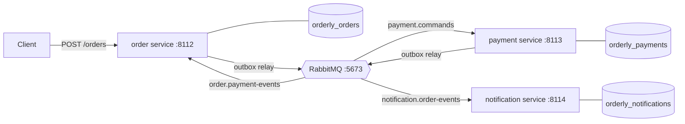

# Orderly

An order-processing monolith split into event-driven services: an **order** service, a **payment** service and a
**notification** service, each with its own PostgreSQL database, talking through RabbitMQ. The interesting part is the
plumbing that keeps such a split correct: a transactional outbox, idempotent consumers, a saga with compensations
(including a payment reply that never comes), retries, dead letters, and measurements of what the split costs against
the monolith.

Python 3.11, FastAPI, RabbitMQ 4.3 (aio-pika), PostgreSQL 14 (psycopg 3), pytest. MIT licensed.

**Status: day 1 of 5.** The design, the message contracts, the RabbitMQ topology, the database schemas and their
migrations, the local RabbitMQ and PostgreSQL scripts, and CI are done. The monolith and the services come on days 2
and 3 ([DESIGN.md](DESIGN.md) "Days").

## Architecture



- The order service runs the saga (orchestration): it reserves stock, sends `payment.charge`, and confirms or cancels
  on the reply; if no reply comes by a deadline it cancels and sends `payment.refund`, because "no answer" doesn't mean
  "not charged". The payment service makes charge and refund commute, so their order doesn't matter.
- Notifications are choreographed: the notification service subscribes to `order.confirmed` and `order.cancelled`.
- No service publishes directly: each writes messages to an outbox table in the same transaction as its change, and
  a relay publishes them (at least once). Every consumer deduplicates by message id.

[DESIGN.md](DESIGN.md) is the full specification: the monolith baseline and what it gets wrong, orchestration vs
choreography, the saga's states, the message table, the topology, the outbox, the failure table.

## What's here (day 1)

| Path | What it is |
|---|---|
| `src/orderly/messages.py` | The contract: a JSON envelope around seven typed payloads; `decode` is strict and says why it refuses, `encode` is canonical |
| `src/orderly/topology.py` | Exchanges, quorum queues, dead-letter queues and bindings as code; `routes()` says where each type goes |
| `src/orderly/broker.py` | Persistent, mandatory, confirmed publishing on a channel where a returned message is an error |
| `src/orderly/migrate.py`, `src/orderly/migrations/` | Numbered SQL migrations per service, applied in one transaction under an advisory lock; edited history refused |
| `scripts/rabbitmq.sh` | A local RabbitMQ node on 127.0.0.1:5673, kept apart from any other RabbitMQ on the machine |
| `scripts/postgres.sh` | Creates, migrates, lists and drops Orderly's databases on the local PostgreSQL 14 |
| `scripts/measure_test_fixture.py` | Times CREATE DATABASE against CREATE SCHEMA (why each test gets a schema) |
| `tests/` | 134 tests: unit, property and integration tests against the real servers |
| `.github/workflows/ci.yml` | Lint, mypy --strict and the suite with PostgreSQL 14 and RabbitMQ 4.3 service containers |

## Run it

Needs Python 3.11, RabbitMQ (`brew install rabbitmq`) and a PostgreSQL 14 server on localhost:5432.

```bash
make venv              # .venv with the package and its dev tools
make services-up       # scripts/rabbitmq.sh start + scripts/postgres.sh create (databases, migrations)
make check             # ruff, ruff format --check, mypy --strict, pytest
make services-down     # stop the RabbitMQ node (the databases stay)
```

The scripts on their own:

```bash
scripts/rabbitmq.sh start | stop | status | url | logs [n] | reset
scripts/postgres.sh create | migrate | status | drop
.venv/bin/python -m orderly.migrate orders --url postgresql://localhost:5432/orderly_orders
```

`rabbitmq.sh` keeps its node's data, logs and config in `.rabbitmq/`, ignores Homebrew's `rabbitmq-env.conf` and
`enabled_plugins` (which would add the management UI, MQTT, STOMP and streams, each on another port), and binds AMQP,
Erlang distribution (25673) and epmd to loopback.

## Tests

`make check` runs 134 tests in about 20 s here (more while the machine is busy):

- **Messages** (49): the canonical bytes pinned; 39 malformed inputs, each refused for its own reason (duplicate keys,
  NaN, a full-width digit in a time, booleans and floats as integers, non-canonical UUIDs, a 5,000-digit number,
  100,000 nested brackets...); Hypothesis round trips over all seven types; changed fields that decode or are refused,
  never raise anything else; arbitrary bytes.
- **Topology** (23, on a real RabbitMQ): every type reaches exactly the queues `routes()` names; a redeclaration with
  other settings is refused; an unroutable publish is an error; rejected and poison messages are dead-lettered; the
  delivery limit's actual behaviour (below); `topic_matches` agrees with the broker on 1,584 random (pattern, key)
  pairs.
- **Migrations** (21) and **schemas** (31, on PostgreSQL 14): applying once and in order; a failing migration leaves
  nothing, not even the bookkeeping; edited, renamed, newer and gapped histories refused; four migrators started at
  once apply once; each invariant of DESIGN.md "Data" enforced by the database itself.
- **The RabbitMQ script** (9, each starting its own node): start/stop/status, loopback-only listeners, a busy port, a
  foreign directory left alone, a live pid that isn't the node neither signalled nor forgotten, a stale pid file, a
  symlinked directory.
- And one that the package's version matches `pyproject.toml`.

Tests that need a server find it at `ORDERLY_AMQP_URL` and `ORDERLY_TEST_DATABASE_URL` (defaults: the local ones) and
are skipped when it isn't there, except with `ORDERLY_REQUIRE_SERVICES=1` (CI sets it), where a missing server fails
them. Each test isolates itself on the shared servers: a random prefix on every exchange and queue it declares, and a
private schema in the test database.

## Results (day 1)

Measured on an Apple M3 laptop (macOS 26.6.2, on battery), PostgreSQL 14.20, RabbitMQ 4.3.6 (Erlang 28).

| What | Measured | Command |
|---|---|---|
| A poison message (its consumer dies before acking, every time) | dead-lettered after 1 + 10 deliveries, reason `delivery_limit` | `pytest tests/test_topology.py -k keeps_dying` |
| `basic.nack` with requeue, 20 times | never counted toward the limit (no `x-delivery-count`), never dead-lettered | `pytest tests/test_topology.py -k requeueing` |
| CREATE + DROP DATABASE vs SCHEMA | 36-198 + 12-21 ms vs 0.1-0.6 + 0.1-0.3 ms (5 runs each) | `.venv/bin/python scripts/measure_test_fixture.py` |
| Local RabbitMQ node, start to AMQP port open | 1.58, 1.58, 1.59 s | `ORDERLY_RABBITMQ_DIR=.scratch/rmq-measure ORDERLY_RABBITMQ_PORT=24601 ORDERLY_RABBITMQ_NODE=orderly-measure@localhost /usr/bin/time -p scripts/rabbitmq.sh start` (then `stop`; three times) |

The second row is the day's most useful finding: on RabbitMQ 4, requeueing a message is "released", not "failed",
so a consumer that requeues on a transient error would loop forever without the delivery limit ever stopping it. The
retries (day 3) therefore never requeue: they go through wait queues with their own attempt count.

## Design decisions

- **Orchestration for payment, choreography for notifications**: the flow with a timeout and a refund lives in one
  pure transition function and one row per order; the side effect nobody waits for is a subscription.
- **Charge and refund commute** in the payment service (a refund first voids the payment), so retries and dead-letter
  replays can reorder them safely.
- **A strict decoder**: a message that doesn't decode never will, so it is dead-lettered at once, never retried;
  being strict about the canonical form means two services can't disagree on what a message says.
- **Quorum queues with at-least-once dead-lettering** and a delivery limit as the backstop for poison messages.
- **Mandatory, confirmed publishing on a channel that raises on returns**: aio-pika only logs a returned message by
  default, so an unroutable message looked like a success until the first test showed it.
- **The database enforces the invariants too** (stock never negative, a cancellation always has a reason, one payment
  per order...): the code is the first line, the schema the last.
- **Migrations in one transaction under an advisory lock**, history checked by SHA-256 and refused if it differs.

## Limitations (day 1)

- No services yet: the monolith and the order service are day 2, payment and notification day 3.
- The RabbitMQ script tests run only where RabbitMQ is installed; CI uses a service container and skips them.
- One RabbitMQ node: quorum queues are replicated only on a cluster, which this project doesn't run.

## License

MIT. See [LICENSE](LICENSE).
